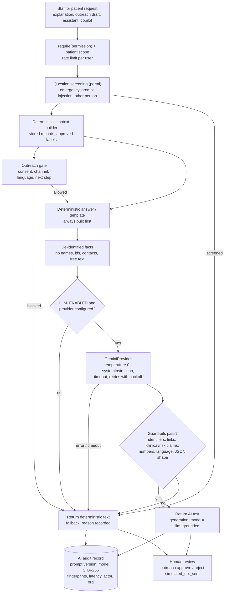

# PulseReach — AI Architecture and Safety

[Docs index](README.md) · [Gemini configuration detail](ai-gemini.md) · [Security](SECURITY_AND_PRIVACY.md)

> **Status:** implemented, **not fully verified**. All provider behaviour is covered by tests with
> a mocked `httpx.post` (`tests/test_ai_service.py`, `test_ai_explanations.py`,
> `test_ai_outreach.py`, `test_patient_assistant.py`, `test_gemini_provider.py`,
> `test_staff_copilot.py`). **No live Gemini call has been made**, because no key has been created yet. AI
> is **off by default** (`LLM_ENABLED=false`), and every feature then returns deterministic
> templates. The staff copilot, portal guide and Gemini provider are **uncommitted** in the working
> tree (migration `0015`).

## Contents
1. [Principle](#1-principle)
2. [Request flow](#2-request-flow)
3. [Components](#3-components)
4. [Prompt templates and versions](#4-prompt-templates-and-versions)
5. [Patient AI assistant](#5-patient-ai-assistant)
6. [Staff AI copilot and staff features](#6-staff-ai-copilot-and-staff-features)
7. [Guardrails and fallback](#7-guardrails-and-fallback)
8. [Status and audit](#8-status-and-audit)
9. [Non-negotiable safety boundaries](#9-non-negotiable-safety-boundaries)

## 1. Principle

The AI **only restates deterministic results** in plain language. Eligibility, statuses, due
dates, care gaps, reasons and rule citations come from the rules engine. A deterministic answer
is always built first, from the same facts, and is returned whenever the model is disabled,
fails, or produces output that fails validation.

## 2. Request flow

Source: [diagrams/ai-request-flow.mmd](diagrams/ai-request-flow.mmd).

## 3. Components

| Component | Location | Role |
|---|---|---|
| Provider abstraction | `app/services/ai/provider.py` (`build_provider`) | `gemini`, `openai_compatible`, `anthropic`; selected explicitly by `LLM_PROVIDER`, with no automatic switching |
| Gemini provider | `GeminiProvider` | `POST {GEMINI_BASE_URL}/models/{model}:generateContent`; key only in the `x-goog-api-key` header; `systemInstruction` separate from user content; `temperature: 0`, `candidateCount: 1`; thought parts discarded; JSON mode for the copilot |
| Model config | `app/core/config.py` | `GEMINI_MODEL` default `gemini-3.5-flash-lite`; `LLM_MAX_OUTPUT_TOKENS` (use 1024 for Gemini); optional `GEMINI_THINKING_LEVEL` |
| Timeouts / retries | provider | `LLM_TIMEOUT_SECONDS` 20 per attempt, `LLM_MAX_RETRIES` 2, `LLM_TOTAL_TIMEOUT_SECONDS` 45; retries only timeouts, network errors, 429 and 5xx, with exponential backoff and jitter; `Retry-After` honoured |
| Error kinds | provider | `timeout`, `network`, `rate_limited`, `server_error`, `auth`, `bad_request`, `blocked`, `truncated`, `invalid_response`, `adapter_error` (never contain provider text or keys) |
| Orchestration | `app/services/ai/service.py` (`AIService._generate`) | Calls provider, validates, falls back, writes the AI audit |
| Context builders | `app/services/explanation/context.py`, `outreach/drafting.py`, `portal_assistant.py`, `copilot.py` | Deterministic, scope-checked facts from stored records |
| Guardrails | `app/services/ai/guardrails.py` | Output validation, question screening, strict JSON parsing |
| Prompts | `app/services/ai/prompts.py` | Versioned system prompts |
| Audit | `app/services/ai/audit.py` → `synthetic.ai_audit_record` (durable in `db` mode) | Per-generation metadata |

The secret path is described in [GCP_DEPLOYMENT_AND_OPERATIONS.md](GCP_DEPLOYMENT_AND_OPERATIONS.md#4-secrets):
Secret Manager → `GEMINI_API_KEY` env var → `SecretStr`. The key is never logged, returned or sent
to the frontend.

## 4. Prompt templates and versions

Verified from `GET /api/v1/ai/status` on 2026-11-20:

| Feature (`ai_audit.feature`) | Prompt version | Endpoint |
|---|---|---|
| `explanation` | `explanation-v2` | `POST /api/v1/explanations` |
| `outreach_draft` | `outreach-v3` | `POST /api/v1/outreach/draft` (+ `/outreach/preview`, `/outreach/draft/review`) |
| `population_insight` | `population-v1` | `GET /api/v1/insights/population` |
| `patient_assistant` | `patient-assistant-v2` | `POST /api/v1/portal/recommendations/{id}/assistant` |
| `portal_assistant` | `portal-assistant-v1` | `POST /api/v1/portal/assistant` |
| `staff_copilot` | `staff-copilot-v1` | `POST /api/v1/ai/copilot/*` |

A wording change to a prompt requires bumping its version.

## 5. Patient AI assistant

Two portal endpoints. Both require `patients.read_self` and work only on the caller's own linked
record (the patient id is resolved on the server, never taken from the request).

| Endpoint | Topics | Facts sent |
|---|---|---|
| `POST /portal/recommendations/{id}/assistant` | `why`, `meaning`, `next_steps`, `prepare_questions`, `appointments`, `question` | That recommendation's localized title, status label, display dates, deterministic evidence lines, documented next step, appointment/request/follow-up labels |
| `POST /portal/assistant` (portal guide) | `overview`, `portal_help`, `contact_care_team`, `question` | Own counts and labels, fixed portal sections and contact routes |

- **Explains** existing care gaps and recommended pathways, helps patients find their way around
  the portal, and suggests questions to ask a care professional.
- **English and Arabic:** the language comes from the body, user preference or `Accept-Language`;
  the language rules are part of the prompt and the output language is validated.
- **Free-text questions** (`question`) are screened before any provider call. Matches for
  `emergency` (urgent-help escalation), `clinical_question`, `other_person` or `prompt_injection`
  get a fixed deterministic answer with no model call. The question text is never stored, only
  its length and SHA-256 hash. Rate limit: 10 questions/min, 20 topic calls/min per user.
- **Escalation:** every response includes an `escalation` line directing clinical uncertainty to the
  care team.
- No names, ids, dates of birth, staff notes or free text written by people are sent to the
  model. `GET /portal/recommendations/{id}/explanation` is always deterministic.

## 6. Staff AI copilot and staff features

| Feature | Endpoint | Permission | Notes |
|---|---|---|---|
| Coordination summary | `POST /ai/copilot/patients/{id}/coordination` | `followups.read` + patient in scope | Tasks, contact attempts, appointments, open gaps; patient requests only with `patient_requests.manage` |
| Clinical review summary | `POST /ai/copilot/patients/{id}/clinical-review` | `ai.explain` **and** `care_gaps.read` | In-band evaluations, approved reason descriptions, open gaps, documented next steps |
| Population briefing | `POST /ai/copilot/population` | `insights.read` | Aggregates over the caller's own scope plus workflow counts |
| Explanation of a finding | `POST /explanations` | `ai.explain` | Restates the deterministic result; must cite `rule_id` |
| Outreach draft | `POST /outreach/draft` | `outreach.draft` (coordinator) | Consent, channel, language and next-step checks run **before** any provider call; blocked requests are audited as `blocked:<reason>` |
| Outreach review | `POST /outreach/draft/review` | `outreach.review` (coordinator) | Human approve/reject; approval records `simulated_not_sent` |
| Population insight | `GET /insights/population` | `insights.read` | Aggregate narrative; must mention "synthetic" |

Copilot output is strict JSON `{summary, points, questions}`. Suggested next steps are
**deterministic** and never generated. Staff notes, internal notes, patient free text, names,
contact details and record ids never reach the model. Rate limit 20/min per user. Each call is
audited in both the AI audit (`staff_copilot`) and the identity audit (`ai.staff_copilot`).

**Simulated outreach:** every draft carries a banner `[SIMULATED OUTREACH PREVIEW — CHANNEL
(language)]`, and responses carry `sendable: false`, `delivered: false`. DB `CHECK`s reject
`sent`/`delivered`. **No message is ever delivered.** PulseReach has no SMS, e-mail, push or
telephony integration.

## 7. Guardrails and fallback

`validate_output` and its feature-specific variants reject output that contains:

- personal identifiers (Emirates-id pattern, e-mail, phone numbers) or links;
- clinical claims (diagnosis, "you have", cancer, prescribing, medication, treatment plan, cure);
- risk or probability language (risk, likelihood, %, odds, predict);
- status claims not supported by the facts (`overdue`, `due`, `eligible`, `completed`/up-to-date,
  "clinically approved");
- numbers or dates that do not appear in the facts;
- the wrong language, excessive length, or a malformed JSON shape (copilot).

| `fallback_reason` | Cause |
|---|---|
| `llm_disabled` | `LLM_ENABLED=false` |
| `llm_misconfigured` | Enabled but key or model missing/invalid |
| `provider_error` | Any provider failure (kind in `extra.provider_error_kind`) |
| `output_rejected` | Guardrail violation (listed in `violations`) |
| `blocked:<reason>` | Outreach gate or question screening refused before any call |

## 8. Status and audit

- `GET /api/v1/ai/status` (`platform.status`): `llm_enabled`, `status`, `availability`
  (`disabled` · `misconfigured` · `configured_unverified` · `last_call_succeeded` ·
  `last_call_failed`), provider, model, last call outcome and error kind, prompt versions. It makes
  no provider call. Verified locally: `availability = disabled`.
- `GET /api/v1/ai/audit` (`audit_logs.read`, organisation-scoped): feature, subject, prompt
  version, provider, model, generation mode, fallback reason, violations, latency, SHA-256
  fingerprints of input/output (not the text), actor user/role/organisation.

## 9. Non-negotiable safety boundaries

| Boundary | How it is enforced |
|---|---|
| AI does not diagnose | Prompt rules + `clinical_claim` guardrail; no diagnostic data model |
| AI does not determine eligibility | Eligibility is computed only by `EvaluationEngine`; `eligible` claims are rejected unless the status supports them |
| AI does not modify deterministic rules | Rules are loaded only from versioned YAML; no rule-editing endpoint exists (`rules.manage` is reserved) |
| AI does not change risk scores | No risk score exists; risk/probability wording is rejected |
| AI does not mark care as completed | Closure requires a staff `completion_documented` event with validated evidence |
| AI does not send messages | No delivery integration; outreach is `simulated_not_sent` after human review |
| AI does not modify clinical records | AI endpoints only read; the only write is the AI audit record |
| AI does not access unauthorised data | The permission and patient-scope check runs before any context is built; out-of-scope ids → 404 |

**Human review:** staff see `generation_mode`, `ai_available`, a draft notice and a disclaimer on
every AI output. Outreach needs an explicit approve/reject by an `outreach.review` holder.
