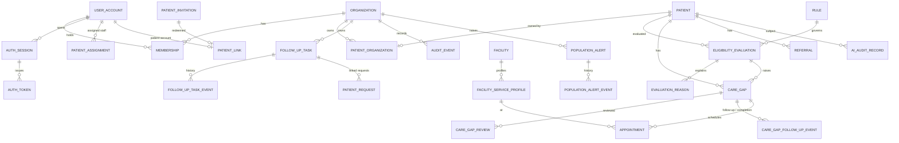

# PulseReach — API and Database Reference

[Docs index](README.md) · [Architecture](SYSTEM_ARCHITECTURE.md) · [Full contracts](api-contracts.md) · [Portal API](patient-portal-api.md) · [ERDs](erd/)

Generated from the running application's route table and dependency markers (2026-11-20; 130
`/api/v1` routes plus `/health`, `/health/db`). Interactive schema: `/docs` (Swagger) and
`/openapi.json`.

## Contents
1. [API](#1-api)
2. [Database](#2-database)

## 1. API

**Authentication:** `Authorization: Bearer <access token>` on every route except those marked
*public*. *auth* = any signed-in user. Permissions joined with `+` are all required; those joined with `|` mean any one is enough.

### 1.1 Health (no `/api/v1` prefix)

| Method | Path | Purpose | Auth |
|---|---|---|---|
| GET | `/health` | Process liveness | public |
| GET | `/health/db` | Database reachability (503 if down) | public |

### 1.2 Authentication and profile

| Method | Path | Purpose | Auth |
|---|---|---|---|
| POST | `/auth/login` | Credentials → token pair, role, permissions | public |
| POST | `/auth/refresh` | Rotate token pair | public |
| POST | `/auth/logout`, `/auth/logout-all` | Revoke current / all sessions | auth |
| POST | `/auth/switch-organization` | New session in another membership | auth |
| POST | `/auth/register` | Patient self-registration (always `202`) | public |
| POST | `/auth/password/change` | Change password | auth |
| POST | `/auth/password-reset/request`, `/confirm` | Reset / activation code redemption | public |
| GET/PATCH | `/me`, `/me/preferences` | Profile, preferred language | auth |

### 1.3 Patients, evaluations, care gaps, rules

| Method | Path | Purpose | Permission |
|---|---|---|---|
| GET | `/dashboard/summary` | Scoped counts and status distribution | `insights.read` |
| GET | `/patients`, `/patients/{id}`, `/history`, `/consents` | Scoped patient list / detail | `patients.read` \| `patients.read_assigned` |
| GET | `/patients/{id}/evaluations` | Evaluation results with reasons | `evaluations.read` |
| POST | `/evaluations` | Run the deterministic engine | `evaluations.run` |
| GET | `/care-gaps`, `/care-gaps/{id}` | Care gaps with evidence references | `care_gaps.read` |
| GET/POST | `/care-gaps/{id}/reviews` | Review history / record a review | `care_gaps.read` / `care_gaps.review` |
| GET/POST | `/care-gaps/{id}/follow-ups` | Follow-up events incl. `completion_documented` | `followups.read` / `followups.create` (completion also needs `care_gaps.complete`) |
| GET | `/patients/{id}/activity` | Engagement timeline | `followups.read` |
| GET | `/programmes/{pathway}/summary` | Programme counts (`ifhas`, `well_child`) | `insights.read` + `care_gaps.read` |
| GET | `/rules`, `/rules/{id}`, `/open-questions[/{id}]` | Rule bundle and open questions | `rules.read` |

### 1.4 Coordination

| Method | Path | Purpose | Permission |
|---|---|---|---|
| GET/POST | `/follow-up-tasks` | List / create tasks | `followups.read` / `followups.create` |
| GET | `/follow-up-tasks/summary`, `/care-team` | Workload, assignable staff | `followups.read` |
| GET/PATCH | `/follow-up-tasks/{id}` | Detail / status, assignee, priority, due date | `followups.read` / `followups.update` |
| POST | `/follow-up-tasks/{id}/{notes,contact-attempts,escalate,complete}` | Task actions (complete needs evidence) | `followups.update` |
| GET/PATCH | `/patient-requests[/{id}]` | Patient requests and staff response | `patient_requests.manage` |
| GET/POST | `/appointments` | List / schedule | `appointments.read` / `appointments.create` |
| PATCH | `/appointments/{id}` | Update status | `appointments.update` |
| GET/POST/PATCH | `/referrals[/{id}]` | Referrals | `referrals.read` / `.create` / `.update` |
| GET | `/appointments/{id}/history`, `/referrals/{id}/history` | Status history | `*.read` |
| POST | `/patients/{id}/portal-invitations` | One-time portal invitation | `patient_links.invite` |

### 1.5 Facilities

| Method | Path | Purpose | Permission |
|---|---|---|---|
| GET | `/facilities`, `/facilities/{ch_fid}` | SDI register | `facilities.read` |
| GET | `/facilities/points` | Mappable care facilities (1,625) + register reduction counts | `facilities.read` |
| GET | `/facility-service-profiles` | Synthetic service profiles | `facilities.read` |

### 1.6 Population intelligence (`/population`)

| Method | Path | Purpose | Permission |
|---|---|---|---|
| GET | `/map`, `/trends`, `/hotspots`, `/areas/{id}`, `/summary` | Suppressed area aggregates | `population.read` |
| GET | `/alerts`, `/alerts/{id}` | Alerts with history | `population.alerts.read` |
| PATCH | `/alerts/{id}` | Alert lifecycle transition | `population.alerts.manage` |
| GET | `/updates` | Aggregation freshness | `population.read` \| `population.refresh` |
| POST | `/refresh` | Manual aggregation run | `population.refresh` |
| GET / PATCH | `/config` | Thresholds | `population.read` \| `population.configure` / `population.configure` |
| GET | `/insights/population` (no `/population` prefix) | Scoped insight + AI narrative | `insights.read` |

### 1.7 AI

| Method | Path | Purpose | Permission |
|---|---|---|---|
| POST | `/explanations` | Explanation of a deterministic result | `ai.explain` |
| POST | `/outreach/preview`, `/outreach/draft` | Gate check / simulated draft | `outreach.draft` |
| POST | `/outreach/draft/review` | Human approve / reject | `outreach.review` |
| POST | `/ai/copilot/patients/{id}/coordination` | Coordination summary | `followups.read` |
| POST | `/ai/copilot/patients/{id}/clinical-review` | Clinical review summary | `ai.explain` + `care_gaps.read` |
| POST | `/ai/copilot/population` | Population briefing | `insights.read` |
| GET | `/ai/status` | Configuration and last call outcome | `platform.status` |
| GET | `/ai/audit` | AI audit records (organisation) | `audit_logs.read` |

### 1.8 Administration and audit

| Method | Path | Permission |
|---|---|---|
| GET/POST | `/admin/organizations` | `organizations.manage` |
| POST | `/admin/patient-ownership`, `/admin/patient-ownership/release` | `organizations.manage` |
| GET/POST | `/admin/users`; GET/PATCH `/admin/users/{id}` | `users.read` / `users.create` / `users.update` |
| POST | `/admin/users/{id}/deactivate`, `/activate` | `users.deactivate` |
| POST | `/admin/users/{id}/password-reset` | `users.update` |
| GET/POST | `/admin/assignments`, `/admin/assignments/staff`, `/admin/assignments/{id}/end` | `assignments.manage` |
| GET/POST | `/admin/patient-links`, `/admin/patient-links/{id}/revoke` | `patient_links.manage` |
| GET | `/audit-events` | `audit_logs.read` |

### 1.9 Patient portal (`/portal`)

All require `patients.read_self` and an active link (`POST /portal/link` only needs *auth*).
Routes: `summary`, `health-summary`, `evaluations`, `recommendations[/{id}[/explanation|/assistant]]`,
`assistant`, `appointments[/{id}]`, `appointments/{id}/change-requests`, `appointment-requests`,
`referrals[/{id}]`, `assistance`, `requests[/{id}[/cancel]]`,
`follow-ups[/{id}[/history|/responses|/assistance|/appointment-request]]`. Details:
[patient-portal-api.md](patient-portal-api.md).

## 2. Database

Alembic head: `0015` (uncommitted; `0014` is the last committed revision). Table list verified
from the SQLAlchemy metadata.

### 2.1 Main entities and relationships

`patient_id` in identity/engagement tables refers to `synthetic.patient` logically (identity tables
use their own MetaData, so there is no cross-schema FK).

### 2.2 Tables by schema

| Schema | Tables |
|---|---|
| `official` | `source`, `source_file`, `region`, `license_status_map`, `facility`, `indicator`, `indicator_dimension`, `dimension_member`, `observation` |
| `clinical` | `rule_load`, `standard`, `verification_status`, `evaluation_status`, `reason_code`, `guard`, `rule`, `rule_condition`, `rule_item`, `open_question`, `rule_open_question`, `rule_item_open_question` |
| `synthetic` | `generation_run`, `evaluation_run`, `facility_service_profile`, `patient`, `guardian`, `consent`, `history_availability`, `condition_record`, `eligibility_evaluation`, `evaluation_reason`, `ifhas_screening`, `well_child_visit`, `component_result`, `assessment`, `appointment`, `referral`, `care_gap`, `care_gap_review`, `care_gap_follow_up_event`, `workflow_status_event`, `outreach_event`, `ai_audit_record` |
| `identity` | `organization`, `user_account`, `membership`, `auth_session`, `auth_token`, `one_time_token`, `patient_organization`, `patient_assignment`, `patient_invitation`, `patient_link`, `audit_event` |
| `engagement` | `follow_up_task`, `follow_up_task_event`, `patient_request` |
| `population` | `geo_area`, `aggregation_run`, `threshold_config`, `population_alert`, `population_alert_event` |

### 2.3 Key rules

| Concern | Rule |
|---|---|
| Organisation ownership | `identity.patient_organization`: at most one owning org per patient; all patient-derived data inherits it |
| Patient linkage | `identity.patient_link`: at most one active link per patient and per account (partial unique indexes) |
| Care-gap closure | `care_gap.closed_by_*` references the evidence row (screening, visit, component, referral, consent) |
| Follow-up task | Optional `care_gap_id`; must belong to the task's patient; completion needs a `completion_documented` event id |
| Appointment / referral | Belong to a patient (and optionally a care gap); status history in `workflow_status_event` |
| Audit | `identity.audit_event` and `population_alert_event` append-only (triggers); `ai_audit_record` stores fingerprints only |
| Synthetic marker | `is_synthetic = true` `CHECK` on patient rows; outreach statuses `sent`/`delivered` rejected |

### 2.4 Migrations

| Rev | Adds |
|---|---|
| 0001–0005 | Schemas, official tables, views, reconciliation |
| 0006–0007 | Clinical and synthetic tables |
| 0008–0009 | Care-gap follow-up events, workflow history |
| 0010 | Evaluation snapshot, AI audit |
| 0011 | Identity and engagement schemas |
| 0012 | Condition records, population schema |
| 0013 | Task priority, contact attempts |
| 0014 | Patient-assistant AI audit feature |
| 0015 | Portal-assistant and staff-copilot AI audit features (**uncommitted**) |
