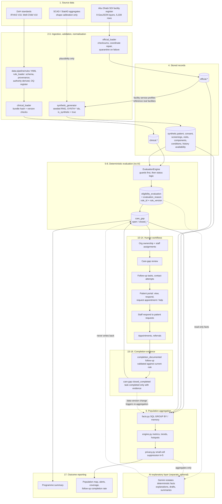

# PulseReach — Data Pipeline, Evaluation and Workflow

[Docs index](README.md) · [Architecture](SYSTEM_ARCHITECTURE.md) · [AI](AI_ARCHITECTURE_AND_SAFETY.md) · [Roles & workflows](USER_ROLES_AND_WORKFLOWS.md)

## Contents
1. [End-to-end diagram](#1-end-to-end-diagram)
2. [Stage-by-stage lifecycle](#2-stage-by-stage-lifecycle)
3. [Deterministic evaluation engine](#3-deterministic-evaluation-engine)
4. [Completion and re-evaluation](#4-completion-and-re-evaluation)
5. [Population aggregation](#5-population-aggregation)
6. [Geographic intelligence and facilities](#6-geographic-intelligence-and-facilities)
7. [Where privacy and validation apply](#7-where-privacy-and-validation-apply)
8. [Commands](#8-commands)

## 1. End-to-end diagram

Source: [diagrams/data-pipeline-flow.mmd](diagrams/data-pipeline-flow.mmd). Solid arrows carry
data; dotted arrows into the AI layer are **read-only** — AI never writes evaluations or care gaps.



## 2. Stage-by-stage lifecycle

| # | Stage | Category | Implementation | Status |
|---|---|---|---|---|
| 1 | Source data | Source | DoH IFHAS V10 and Well-Child V10 PDFs (transcribed to YAML); Abu Dhabi SDI GeoJSON register (`data/raw/abudhabi_sdi/`); SCAD/StatAD aggregates (`data/raw/scad`, `statad_api`), checksummed in `data/reference/raw_checksums.sha256` | Verified |
| 2 | Ingestion / loading | Source → stored | `data-pipeline/ingestion/*` (fetch scripts), `app/services/official_loader`, `app/services/clinical_loader`, `app/services/synthetic_generator` | Verified |
| 3 | Validation and normalisation | Stored | Rule loader rejects unknown keys and missing provenance, and derives authority (`verified` and not review-flagged); facility loader repairs transposed coordinates and quarantines on failure; seed reconciles row counts and rolls back on mismatch (exit 2) | Verified |
| 4 | Patient and clinical storage | Stored | `synthetic.patient`, `guardian`, `consent`, `history_availability`, `ifhas_screening`, `well_child_visit`, `component_result`, `assessment`, `condition_record` | Verified |
| 5 | Clinical rules and evaluation | Evaluation | `EvaluationEngine` (`app/services/evaluation/engine.py`, `ENGINE_VERSION 0.1.0`) | Verified |
| 6 | Care-gap identification | Care-gap generation | Gap types `no_documented_screening`, `interval_elapsed`, `visit_not_attended`, `partial_completion`, `referral_not_initiated` | Verified |
| 7 | Evidence and provenance | Evaluation | Every evaluation stores `rule_id`, `rule_version`, reason codes (`evaluation_reason`), guard that fired and an input snapshot (migration 0010) | Verified |
| 8 | Care-gap persistence | Care-gap generation | `synthetic.care_gap` with `closed_by_*` evidence columns; status history in `workflow_status_event` | Verified |
| 9 | Population aggregation | Reporting | `app/services/population/*` → `population.aggregation_run.snapshot` | Verified (memory/PG parity test) |
| 10 | Programme and patient assignment | Human workflow | `identity.patient_organization`, `identity.patient_assignment` (`/admin/patient-ownership`, `/admin/assignments`) | Verified |
| 11 | Coordinator follow-up | Human workflow | `engagement.follow_up_task` + append-only `follow_up_task_event` (notes, priority, contact attempts, escalation) | Verified |
| 12 | Appointments and referrals | Human workflow | `synthetic.appointment`, `synthetic.referral` + history (`/appointments`, `/referrals`) | Verified |
| 13 | Patient portal visibility | Patient engagement | `/portal/*` shows only patient-visible tasks and events, recommendations, appointments, referrals | Verified |
| 14 | Patient requests and staff responses | Patient engagement | `engagement.patient_request` (`appointment`, `assistance`, change requests); `PATCH /patient-requests/{id}` | Verified |
| 15 | Evidence-based completion | Completion evidence | `POST /care-gaps/{id}/follow-ups` with `completion_documented` validated by `followup/completion.py` against the current rule | Verified |
| 16 | Re-evaluation and status updates | Evaluation | `POST /evaluations` (`evaluations.run`) re-runs the engine for a patient; completion closes the gap as `closed_completed` | Verified |
| 17 | Outcome metrics | Reporting | Programme summary, preventive coverage, screening completions, follow-up completion rate | Verified |

Synthetic seed used in the demo: `SYNTH-RUN-0001`, **550 patients**, reference date
**2026-11-16** (org A = region 1: 379 people; org B = regions 2–3: 171 people), measured on a
local memory-mode run on 2026-11-20.

## 3. Deterministic evaluation engine

- **Rule bundle:** `data-pipeline/rules/` — IFHAS 29 rules, Well-Child 25 rules (54 total, 47
  authoritative). Each rule carries `source_reference` (document, section, PDF page),
  `verification_status` and version history. See [clinical-rules.md](clinical-rules.md).
- **Guards first:** missing date of birth → `insufficient_information`; missing history →
  `unknown` (never "not completed"); conflicting records or non-authoritative rule →
  `requires_clinical_review`. `overdue` is never produced for Well-Child visits while
  `OQ-WCV-DUE-WINDOW` is open.
- **Separation of concerns:** programme eligibility, package/visit eligibility, care gaps,
  history availability and evaluation status are computed and stored separately.
- **Statuses:** `eligible`, `not_eligible`, `due`, `upcoming`, `overdue`, `completed`, `unknown`,
  `insufficient_information`, `requires_clinical_review`.
- **No LLM or statistical model** is involved in eligibility, due dates or gaps. There is no risk score in the system.

Demo dataset (org A, measured): 1,002 open care gaps; 2,613 `eligible`, 1,007 `due`, 192
`completed`, 338 `unknown`, 3,389 `requires_clinical_review` evaluations.

## 4. Completion and re-evaluation

1. Staff record a follow-up event on the gap (`POST /care-gaps/{id}/follow-ups`). Event types
   include appointment, referral, outreach and `completion_documented`.
2. `completion_documented` must reference evidence (screening, visit, component result, referral
   or consent) that satisfies the **current** rule version; otherwise `422`.
3. The gap closes (`closed_completed`, with the `closed_by_*` reference set).
4. A follow-up task linked to that gap can complete only with that evidence id
   (`POST /follow-up-tasks/{id}/complete`, `422 workflow.completion_evidence_required` otherwise).
5. A patient answer of `already_done` only sets `patient_reported_completion = true` for staff
   verification. **Patients and AI cannot close a gap.**
6. The population data-version fingerprint changes, so the next read schedules a re-aggregation.

## 5. Population aggregation

`facts.py` (PostgreSQL `GROUP BY` or memory, kept identical by a parity test) → `engine.py`
(pure metrics, trends, threshold hotspots, alert candidates) → `privacy.py` (suppression) →
`views.py`. Snapshots are persisted per organisation; stale snapshots are served with
`aggregation.stale = true` and refreshed in a background task. Full definitions:
[geospatial-population-intelligence.md](geospatial-population-intelligence.md).

| Metric family | Examples |
|---|---|
| Disease (synthetic condition records) | `new_cases`, `patients_with_condition`, `prevalence`, trend, hotspot class |
| Preventive care (from the engine) | `open_care_gaps`, `preventive_coverage`, `screening_completions` |
| Operations | `follow_up_completion_rate` |
| Access | `care_facilities` per area |

Hotspots are threshold rules (`method: "threshold_rules"`, `statistical_significance:
"not_assessed"`) and are never labelled outbreaks.

## 6. Geographic intelligence and facilities

**Facility source:** Abu Dhabi Spatial Data Infrastructure (SDI) facility register, 9 GeoJSON
layers, **5,339** published rows (`data/processed/facilities/quality_report.json`).

| Step | Count (verified via `/facilities/points` on 2026-11-20 and the Phase 7 audit) |
|---|---|
| Published register (9 layers) | 5,339 |
| Care layers (hospitals 114, health centres 1,290, clinics 1,250) | 2,654 |
| Care layers, identified, `geo_quality = ok`, licence `Active` → **listed and mapped** | **1,625** (hospitals 71, health centres 808, clinics 746) |
| Excluded without usable coordinates (reported by the API) | 1 |

- **Inclusion logic:** care layers only; licence status `Active` (the `Temporary Closure` value in
  the filter never matches the register's `Temporary Closed` — licence policy is open decision D13);
  facilities without usable coordinates are excluded, never placed at a default point.
- **Directory and map** use the same 1,625-facility subset (`GET /facilities/points`). The
  general `GET /facilities` listing returns 2,985 rows (other filters, not mapped).
- **Not published by the source:** preventive-programme capability, capacity, operating status.
  The directory says so explicitly.
- **Areas:** country → emirate → 3 districts (`official.region`) → local areas (the synthetic
  patient `district_label`). **No boundaries and no patient coordinates exist.** Alerting areas
  are drawn as the bounding box of the published facility points in that area (labelled as such).
  These are approximate area positions and **never individual patient locations**.
- **Patients without a local area** are counted at district level only, never in a guessed area.
- **Small-cell suppression** (`POPULATION_MIN_CELL_SIZE = 5`, system-wide): primary,
  cohort-complement and complementary suppression; suppressed values are `null`, never `0`.
- **Map tiles:** OpenFreeMap vector tiles (`tiles.openfreemap.org`, no key), attribution
  "OpenFreeMap © OpenMapTiles © OpenStreetMap contributors" rendered in the map.
- **Fallback:** if WebGL or tiles are unavailable the population data remains available in the
  list/table views; the facility directory works without the map.
- **Access:** the map is shown only with `population.read` (PHM, clinician).

## 7. Where privacy and validation apply

| Stage | Protection |
|---|---|
| Generation | `is_synthetic = true` (DB `CHECK`), `SYNTH-*` ids, `SYNTH-EID-*` Emirates ids that fail the real format, `(synthetic)` names, `.invalid` e-mails, reserved phone range |
| Loading | Schema validation, checksums, row-count reconciliation, transactional rollback |
| Evaluation | Authority guard: non-authoritative rules can only yield `requires_clinical_review` |
| API reads | Permission + patient scope filter applied *before* counting/pagination; out-of-scope ids → 404 |
| Portal | Reason codes, guards, staff notes, reviewer identities and Emirates ids never returned |
| Aggregation | No patient identifiers in snapshots; k = 5 suppression |
| AI | Only de-identified facts sent; output guardrails; fingerprints (not texts) in the audit |

## 8. Commands

```bash
cd backend
alembic upgrade head                                  # schemas 0001–0015
python -m app.services.official_loader                # SDI register + SCAD
python -m app.services.synthetic_generator.seed       # rules + synthetic data (exit 2 on failure)
python -m app.db.init --seed                          # idempotent all-in-one (used by Compose / init job)
python -m app.services.population refresh             # optional scheduled aggregation
```

**Warning:** the explicit reseed deletes follow-up, workflow and AI audit history. Never run it
against a live demo database.
