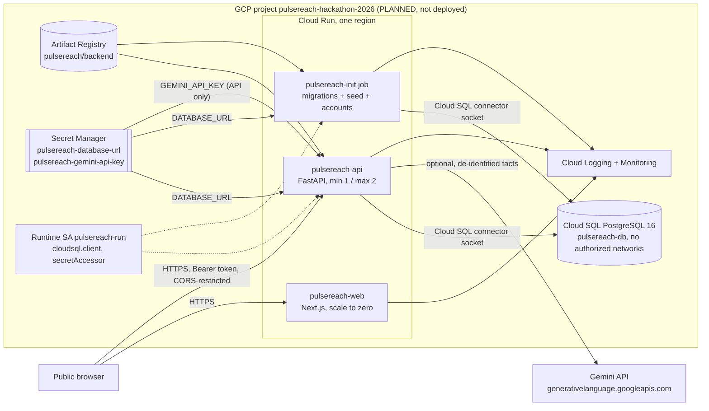

# PulseReach — GCP Deployment and Operations

[Docs index](README.md) · [Step-by-step runbook](deployment-gcp.md) · [Security checklist](deployment-security-checklist.md) · [Gemini](ai-gemini.md)

> **Deployment status: PENDING — nothing is deployed.** A read-only `gcloud` check of project
> `pulsereach-hackathon-2026` on 2026-11-20 listed **0** Cloud Run services, **0** Cloud Run jobs,
> **0** Cloud SQL instances, **0** secrets and **0** Artifact Registry repositories. Every resource
> name below is the **planned** name from the runbook. No public URL exists yet.

## Contents
1. [Planned architecture](#1-planned-architecture)
2. [Resources](#2-resources)
3. [Environment configuration](#3-environment-configuration)
4. [Secrets](#4-secrets)
5. [Deployment procedure](#5-deployment-procedure)
6. [Database migration](#6-database-migration)
7. [Health checks and smoke tests](#7-health-checks-and-smoke-tests)
8. [Monitoring](#8-monitoring)
9. [Rollback](#9-rollback)
10. [Running locally](#10-running-locally)

## 1. Planned architecture

Source: [diagrams/deployment-architecture.mmd](diagrams/deployment-architecture.mmd).



**Boundaries:** the database has no authorised networks, so only the IAM-authorised Cloud SQL
connector (used by the API service and the init job) can reach it. Only the API service mounts the Gemini
secret. Only the runtime service account `pulsereach-run` can read secrets, and only the two named
secrets. The browser never sees a secret or calls Gemini.

## 2. Resources

| Resource | Planned name / setting | Status |
|---|---|---|
| Project | `pulsereach-hackathon-2026` (exists; APIs enabled per runbook) | Exists, empty |
| Region | One region for everything, e.g. `us-central1` (`me-central1` is closer to Abu Dhabi; costs more) | Not chosen |
| Backend service | Cloud Run `pulsereach-api` — image from `backend/Dockerfile` (Python 3.12-slim, `uvicorn` on `$PORT`), 1 vCPU / 1 GiB, min 1 / max 2 instances, concurrency 40, timeout 60 s | Pending |
| Init job | Cloud Run job `pulsereach-init` — same image, `python -m app.db.init --seed` | Pending |
| Frontend service | Cloud Run `pulsereach-web` — `gcloud run deploy --source frontend` (buildpacks; no frontend Dockerfile), scale to zero | Pending |
| Database | Cloud SQL PostgreSQL 16 `pulsereach-db`, `db-g1-small`, 10 GB SSD, automated backups | Pending |
| Registry | Artifact Registry `pulsereach` (docker) | Pending |
| Secrets | `pulsereach-database-url`, `pulsereach-gemini-api-key` | Pending |
| Service account | `pulsereach-run` (`roles/cloudsql.client`, `secretAccessor` on the two secrets) | Pending |
| Logging / Monitoring | Cloud Run default logs (structured JSON from the app) and metrics | Pending |

## 3. Environment configuration

| Variable | Production value | Secret |
|---|---|---|
| `AUTH_MODE` | `users` (never `legacy`) | no |
| `DATA_SOURCE` | `db` | no |
| `DATABASE_URL` | `postgresql+psycopg://…@/pulsereach?host=/cloudsql/<connection>` | **yes** |
| `CORS_ORIGINS` | the `pulsereach-web` origin only | no |
| `TRUSTED_PROXY_HOPS` | `1` | no |
| `SELF_REGISTRATION_ENABLED` | `false` for judging | no |
| `DEMO_IDENTITY_SEED` | unset (memory mode only) | no |
| `POPULATION_MIN_CELL_SIZE` | `5` (do not lower) | no |
| `LLM_ENABLED` / `LLM_PROVIDER` | `false`, or `true` + `gemini` | no |
| `GEMINI_API_KEY` | from Secret Manager | **yes** |
| `GEMINI_MODEL` / `LLM_MAX_OUTPUT_TOKENS` | `gemini-3.5-flash-lite` / `1024` | no |
| Frontend build: `NEXT_PUBLIC_API_URL` | the `pulsereach-api` URL | no |

No AI setting or key is ever given to the frontend or to any `NEXT_PUBLIC_*` variable.

## 4. Secrets

Gemini key (Google AI Studio, restricted to `generativelanguage.googleapis.com`) → Secret Manager
`pulsereach-gemini-api-key` (created from stdin) → `--set-secrets=GEMINI_API_KEY=…:latest` on the
API service → `Settings.gemini_api_key` (`SecretStr`). The DB URL follows the same path. No
service-account key files, no `--set-env-vars` for secrets. Rotation, disable and revocation:
[deployment-gcp.md §3a](deployment-gcp.md).

## 5. Deployment procedure

Commands are in [deployment-gcp.md §3–5](deployment-gcp.md). Each step needs explicit approval:

1. Create the Artifact Registry repo, Cloud SQL instance, database and user, secrets and runtime SA.
2. Build the backend image with Cloud Build (`backend/Dockerfile`, repo-root context; copy
   `.dockerignore` to `.gcloudignore` so `data/` is uploaded).
3. Create and execute the `pulsereach-init` job (migrations + official register + synthetic seed).
4. Deploy `pulsereach-api` with secrets and env vars.
5. Deploy `pulsereach-web` with `NEXT_PUBLIC_API_URL`; then redeploy the API with the final
   `CORS_ORIGINS`.
6. Create accounts via the job: `create-admin`, then `seed-demo` (prints random per-user
   passwords **once**, or uses `DEMO_IDENTITY_PASSWORD` for that single command).

## 6. Database migration

`python -m app.db.init --seed` applies Alembic to head, loads the official register only if empty
and seeds synthetic data only if no generation run exists. This makes it idempotent and it never reseeds. The
startup check refuses to serve if the rule bundle and the DB load do not match, so a broken
revision never receives traffic. Destructive downgrades need `-x allow_data_loss=true`. **Never
run `app.services.synthetic_generator.seed` against the judging DB** (it wipes workflow history).

## 7. Health checks and smoke tests

| Check | Expected |
|---|---|
| `GET /health` | `{"status":"ok"}` |
| `GET /health/db` | `{"database":"ok"}` (503 if unreachable) |
| `GET /api/v1/patients` without token | `401` |
| Login as `manager.a`, `GET /programmes/ifhas/summary` | `200` |
| `GET /api/v1/ai/status` | `availability` = `disabled` or `configured_unverified` → `last_call_succeeded` |
| CORS preflight from a foreign origin | `400` |

## 8. Monitoring

Planned: Cloud Run request/latency/error metrics, structured JSON logs (`request_id`,
`pulsereach.audit` audit mirror, `AUDIT WRITE FAILED` alerts), `/ai/status` for provider health,
and a billing budget alert (~$50). No alerting policies have been created yet (**not run**).

## 9. Rollback

`gcloud run services update-traffic pulsereach-api --to-revisions=<previous>=100`. Schema
rollback is not automatic; for bad data, restore the Cloud SQL backup to a new instance and
repoint the secret. A backup restore drill has **not** been run. Cleanup commands after
judging: [deployment-gcp.md §8](deployment-gcp.md).

## 10. Running locally

```bash
# Docker Compose: PostgreSQL 16 + db-init (app.db.init --seed) + backend
cp .env.example .env && docker compose --env-file .env -f infrastructure/docker-compose.yml up --build

# Disposable memory-mode demo (no database) with demo users
cd backend && DATA_SOURCE=memory DEMO_IDENTITY_SEED=true DEMO_IDENTITY_PASSWORD='<passphrase>' \
  CORS_ORIGINS=http://localhost:3100 .venv/bin/python -m uvicorn app.main:app --port 8001
cd frontend && NEXT_PUBLIC_API_URL=http://localhost:8001 npx next dev -p 3100
```

Verification commands: see [AGENTS.md](../AGENTS.md) (backend pytest, live PostgreSQL suite,
frontend `tsc`/lint/test/build).
