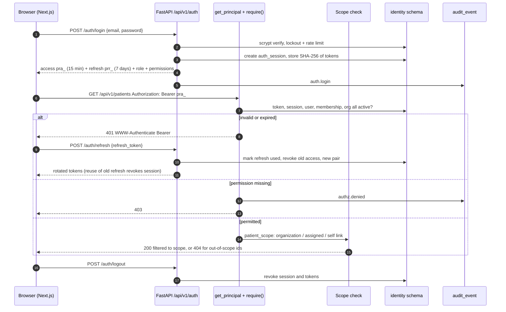

# PulseReach — Security and Privacy

[Docs index](README.md) · [RBAC design detail](authentication-and-rbac.md) · [Deployment checklist](deployment-security-checklist.md)

> Hackathon-grade implementation following standard practices. It has **not** had an independent
> security review and makes **no** HIPAA, GDPR, ADHICS, DoH or other compliance claim. All patient
> data is synthetic.

## Contents
1. [Authentication and RBAC flow](#1-authentication-and-rbac-flow)
2. [Implemented protections](#2-implemented-protections)
3. [Synthetic demo data](#3-synthetic-demo-data)
4. [Known limitations](#4-known-limitations)
5. [Evidence](#5-evidence)

## 1. Authentication and RBAC flow

Source: [diagrams/authentication-and-rbac.mmd](diagrams/authentication-and-rbac.mmd).

## 2. Implemented protections

| Protection | Implementation |
|---|---|
| Individual authentication | `identity.user_account`; scrypt (N=2^17, r=8, p=1) password hashes; 12-character minimum; identical `401` for unknown e-mail, wrong password or disabled account (timing equalised) |
| Tokens and sessions | Opaque random tokens (`pra_` access, 15 min; `prr_` refresh, 7 days; session ≤ 30 days). Only SHA-256 digests are stored. Validated against the server-side session on every request |
| Refresh rotation | A refresh marks the old token used and revokes outstanding access tokens; **reuse of a used refresh token revokes the whole session** (`auth.refresh_reuse_detected`) |
| Logout / revocation | `/auth/logout`, `/auth/logout-all`; password change/reset, deactivation, membership change and link revocation revoke sessions |
| Brute-force | 5 failures → 15-minute account lockout (persistent); 10/min per IP and per identifier on auth endpoints |
| Role-based permissions | 42 permissions in `app/core/permissions.py`; every `/api/v1` route declares `require(...)`, `authenticated` or `public_endpoint` (meta-test in `test_rbac.py`) |
| Organisation isolation | Session-bound organisation (never taken from the request); patient-anchored tenancy via `identity.patient_organization`; lists filtered before counting/pagination |
| Assignment-scoped access | Coordinators and clinicians see only assigned patients unless an admin grants `patient_access = organization` |
| Patient identity linking | Staff-issued one-time code (60-bit, SHA-256 stored, 7-day TTL, 5 attempts) **plus** date of birth. E-mail is never proof of identity; staff accounts cannot be linked |
| Server-side patient context | Portal routes resolve the patient id from the active link; patients never supply it |
| Data minimisation (portal) | No Emirates id, reason codes, guards, input snapshots, staff notes, internal notes or reviewer identities |
| Response filtering | Out-of-scope resources answer `404` with the same body as missing ones (audited `authz.scope_denied`) |
| Audit logging | `identity.audit_event`: every state change, auth event and denial; append-only (PostgreSQL triggers block UPDATE/DELETE/TRUNCATE); `details` hold identifiers only |
| Server-derived actor | Client `recorded_by` / `reviewed_by` / `reviewer` are ignored |
| API hardening | Explicit CORS origins, no credentials; 1 MiB body limit (`413`); no stack traces or SQL in errors; `TRUSTED_PROXY_HOPS` for spoof-resistant client IP |
| Secret management | `DATABASE_URL`, `GEMINI_API_KEY` as `SecretStr`; `.env*` git- and docker-ignored; Secret Manager planned for GCP; no service-account keys |
| Small-cell suppression | `POPULATION_MIN_CELL_SIZE = 5` (system-wide): primary, cohort-complement and complementary suppression, incl. parent-minus-children differencing |
| Area-level geography | Aggregates by district/local area only; no patient coordinates exist |
| AI privacy | De-identified facts only; output identifier guardrail; audit stores fingerprints, not text |

## 3. Synthetic demo data

- Every patient row has `is_synthetic = true` (DB `CHECK`); ids are `SYNTH-*`; Emirates ids are
  `SYNTH-EID-*` tokens that fail the real format; names end with `(synthetic)`; e-mails use
  `@example.invalid`; phones use a reserved range.
- Demo user accounts use `@demo.pulsereach.invalid` and `(synthetic)` display names.
- Official data is limited to the public SDI facility register and SCAD aggregates.

## 4. Known limitations

| Limitation | Note |
|---|---|
| **Isolation is application-level** | No PostgreSQL Row-Level Security; synthetic tables carry no `organization_id`. Enforcement lives in the API layer and is covered by tests |
| Rate limiting is per process | No distributed limiter; Cloud Armor / gateway recommended |
| Audit write is a separate transaction | A failed audit write is logged loudly but does not undo the business write |
| Tokens in `sessionStorage` | Readable by scripts on the origin; an httpOnly-cookie BFF would be stronger |
| Shared demo accounts | 5 wrong passwords lock an account for 15 minutes |
| Public `/docs`, `/openapi.json` | Schema only; every data route needs a token |
| Population differencing residuals | Nested time windows and monthly series are not cross-suppressed; trend direction of suppressed cells is visible |
| No e-mail/SMS | Activation, reset and invitation codes are handed over out of band |
| No HSTS header from the app | HTTPS provided by Cloud Run (when deployed) |
| Data residency | GCP suitability for UAE health data not established (`OQ-GOV-DATA-RESIDENCY`) |
| Monitoring, backup restore, rollback drills | Not run (no deployment exists) |

## 5. Evidence

Tests: `test_auth.py`, `test_rbac.py`, `test_tenant_isolation.py`, `test_cross_org_probes.py`,
`test_patient_portal.py`, `test_audit_events.py`, `test_edge_hardening.py`,
`test_observability.py`, `test_population_*.py`; live PostgreSQL `test_identity_live_pg.py`.
Status table: [deployment-security-checklist.md §7](deployment-security-checklist.md).

Runtime check (local memory mode, 2026-11-20): admin → `/patients` 403; patient →
`/patients` 403 and `/portal/summary` 200; coordinator sees 20 patients, clinician 10, manager A
379 and manager B 171 (disjoint organisations).
