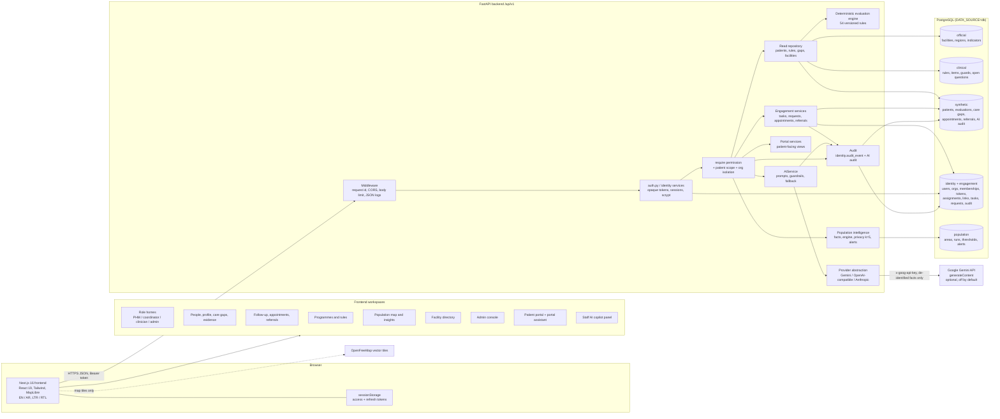

# PulseReach — System Architecture

[Docs index](README.md) · [Data pipeline](DATA_PIPELINE_AND_WORKFLOW.md) · [Security](SECURITY_AND_PRIVACY.md) · [API & DB](API_AND_DATABASE_REFERENCE.md)

## Contents
1. [Architecture diagram](#1-architecture-diagram)
2. [Frontend](#2-frontend)
3. [Backend](#3-backend)
4. [Data layer](#4-data-layer)
5. [External services](#5-external-services)
6. [Runtime modes](#6-runtime-modes)
7. [Repository layout](#7-repository-layout)

## 1. Architecture diagram

Source: [diagrams/system-architecture.mmd](diagrams/system-architecture.mmd). GCP topology
(planned) is a separate diagram in [GCP_DEPLOYMENT_AND_OPERATIONS.md](GCP_DEPLOYMENT_AND_OPERATIONS.md).

The browser talks only to the FastAPI backend (and, for the map, to the OpenFreeMap tile server).
The frontend never calls Gemini and never holds an AI key.

## 2. Frontend

`frontend/` — Next.js 16 (App Router, `cacheComponents`), React 19, TypeScript, Tailwind CSS 4,
MapLibre GL 6 (pinned), Vitest.

| Component | Location | Responsibility |
|---|---|---|
| Auth and session | `lib/auth/auth-context.tsx`, `lib/auth/session.ts`, `lib/api/client.ts` | `GET /me` resolves the session; tokens are kept in `sessionStorage`; on a 401 the client makes one refresh attempt, shared by concurrent requests; requests without a token are refused client-side; data requests are held until a session exists |
| Role homes | `components/home/role-home.tsx`, `components/admin/admin-overview.tsx` | PHM → Population overview, coordinator → My worklist, clinician → My patients, admin → Administration |
| Navigation | `components/shell/nav-items.ts` | Menu per role/permission. **UX only — the backend enforces access** |
| People and profile | `app/people`, `components/people/profile/*` | Patient list, care gaps, evidence trace, assessments, coordination section |
| Follow-up, appointments | `app/follow-up`, `app/appointments`, `components/coordination/*` | Tasks, contact attempts, outreach panel, scheduling |
| Programmes and rules | `app/programmes`, `components/programmes/*` | Programme summary (`/programmes/{pathway}/summary`), rule detail with provenance |
| Population | `app/population`, `components/population/*`, `components/population/geo/*` | Map, trends, hotspots, alerts; panel insights for coordinators/clinicians |
| Facility directory | `app/facilities`, `components/facilities/facility-register.tsx` | Register search and "Show on map" |
| Admin | `app/admin/{users,assignments,patient-links,audit,population}` | Users and roles, assignments, portal links, audit log, aggregation |
| Patient portal | `components/portal/patient-portal.tsx`, `portal-assistant.tsx` | Rendered for `PATIENT` accounts; only `/api/v1/portal/*` requests are allowed through the request gate |
| Staff AI copilot | `components/copilot/copilot-panel.tsx`, `lib/copilot/*` | Review-only summaries on profile/population screens |
| Localisation | `lib/i18n/*`, `components/i18n/*` | `en`/`ar` catalogues with parity tests, RTL, logical CSS |

## 3. Backend

`backend/` — FastAPI, SQLAlchemy 2, Alembic, psycopg, Python 3.12. OpenAPI at `/docs`.

| Component | Location | Responsibility |
|---|---|---|
| App, middleware | `app/main.py`, `app/core/logging.py`, `app/core/errors.py` | CORS (explicit origins), `X-Request-ID`, structured JSON logs with redaction, 1 MiB body limit, localized error bodies without stack traces |
| Startup validation | `app/core/startup.py` | Refuses to start if the rule bundle is missing or the DB has no matching seeded load |
| Authentication | `app/api/auth.py`, `app/services/identity/{service,credentials}.py` | Login, refresh rotation, logout, registration, password reset/activation |
| RBAC | `app/core/permissions.py`, `app/core/auth.py` | Role → permission matrix; `require(...)` on every route; `Principal.patient_scope()` |
| Org isolation | `app/services/identity/directory.py` | Patient ownership, memberships, assignments, portal links |
| Patients, care gaps, rules, facilities | `app/api/v1.py`, `app/repositories/read_repo.py` | Scoped reads (memory and PostgreSQL implementations) |
| Evaluation engine | `app/services/evaluation/engine.py` | Deterministic evaluation of 54 rules; `POST /evaluations` |
| Care pathway | `app/services/care_pathway.py` | Documented next step for a gap |
| Follow-up / completion | `app/services/followup/*`, `app/repositories/followup_repo.py` | Care-gap follow-up events, completion evidence validation, appointments, referrals |
| Engagement | `app/api/engagement.py`, `app/services/identity/engagement.py` | Follow-up tasks, events, patient requests, care team, summaries |
| Patient portal | `app/api/portal.py`, `app/services/portal_assistant.py` | Patient-facing views, requests, assistant facts |
| Programme summary | `app/services/programmes.py` | Server-side programme counts |
| Population intelligence | `app/api/population.py`, `app/services/population/*` | Facts, pure engine, privacy, alerts, snapshots |
| AI | `app/services/ai/*`, `app/services/explanation/*`, `app/services/outreach/*`, `app/services/copilot.py`, `app/api/copilot.py` | Provider abstraction, Gemini, prompts, guardrails, AI audit |
| Audit | `app/services/identity/audit.py`, `app/services/ai/audit.py` | `identity.audit_event` (append-only) and AI audit records |
| Localisation | `app/core/i18n.py` | `en`/`ar` message catalogue, `Accept-Language`/`?lang=` |
| Rate limiting | `app/core/rate_limit.py` | In-process sliding window (per worker) |

## 4. Data layer

PostgreSQL with Alembic migrations `0001`–`0015`. Six schemas:

| Schema | Contents | Tenant-scoped |
|---|---|---|
| `official` | SDI facility register, regions, SCAD indicators, source files | No (public reference data) |
| `clinical` | Rule load, standards, rules, rule items, guards, reason codes, open questions | No (global rules) |
| `synthetic` | Patients, guardians, consents, screenings, visits, evaluations, care gaps, appointments, referrals, follow-up events, outreach events, condition records, AI audit | Through `identity.patient_organization` |
| `identity` | Organizations, users, memberships, sessions, tokens, assignments, invitations, links, audit events | Yes (`organization_id`) |
| `engagement` | Follow-up tasks, task events, patient requests | Yes (`organization_id`) |
| `population` | Geo areas, aggregation runs (snapshots), thresholds, alerts, alert events | Yes, for runs, thresholds and alerts |

Entity details: [API_AND_DATABASE_REFERENCE.md](API_AND_DATABASE_REFERENCE.md#2-database).

## 5. External services

| Service | Used for | Status |
|---|---|---|
| Google Gemini API (`generativelanguage.googleapis.com/v1beta`, `generateContent`) | Optional AI text | Implemented; mocked tests only; no live call yet |
| OpenFreeMap vector tiles | Map basemap (no key; OpenMapTiles / OpenStreetMap attribution shown) | Implemented |
| GCP Cloud Run, Cloud SQL, Secret Manager, Artifact Registry, Logging | Hosting | **Planned, not deployed** |

No SMS, e-mail, push, telephony, EHR/FHIR or identity-provider integration exists.

## 6. Runtime modes

| Setting | Values | Notes |
|---|---|---|
| `DATA_SOURCE` | `memory` / `db` | `memory` builds the synthetic dataset in-process (identity data in an in-process SQLite DB); `db` uses PostgreSQL |
| `AUTH_MODE` | `users` (default) / `legacy` | `legacy` exists only for regression tests and frontend migration; never on an exposed URL |
| `LLM_ENABLED` | `false` (default) / `true` | With `LLM_PROVIDER=gemini` and `GEMINI_API_KEY` |

## 7. Repository layout

| Directory | Purpose |
|---|---|
| `frontend/` | Next.js application |
| `backend/` | FastAPI application, migrations, tests |
| `data-pipeline/` | Rule YAML (`rules/`), rule loader, ingestion scripts, facility transformation |
| `data/` | Raw public sources, metadata, synthetic fixtures (large outputs git-ignored) |
| `infrastructure/` | `docker-compose.yml` (PostgreSQL, db-init, backend) |
| `ml/` | Empty placeholders (`evaluation/`, `experiments/`) — no ML model is used |
| `docs/` | This documentation |
