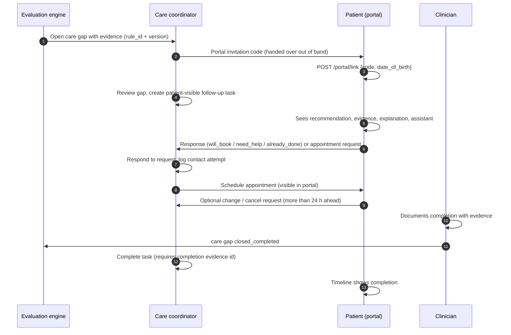

# PulseReach — User Roles and Workflows

[Docs index](README.md) · [Security](SECURITY_AND_PRIVACY.md) · [Demo script](DEMO_SCRIPT.md) · [Portal API](patient-portal-api.md)

## Contents
1. [Roles at a glance](#1-roles-at-a-glance)
2. [Role–permission matrix](#2-rolepermission-matrix)
3. [System administrator](#3-system-administrator)
4. [Population health manager](#4-population-health-manager)
5. [Care coordinator](#5-care-coordinator)
6. [Clinician](#6-clinician)
7. [Patient](#7-patient)
8. [Patient engagement journey](#8-patient-engagement-journey)

The frontend shapes navigation by role, but **this is not a security control**. Every permission and
patient scope is enforced by the backend: `401` without a token, `403` without the permission,
`404` for patients outside the caller's scope.

## 1. Roles at a glance

| Role | Purpose | Organisation scope | Patient scope | Home screen |
|---|---|---|---|---|
| `SYSTEM_ADMIN` | Accounts, organisation, assignments, portal links, audit, aggregation operations | Own organisation | **None** (no patient-data permissions) | Administration console |
| `POPULATION_HEALTH_MANAGER` | Population oversight, programmes, assignments, follow-up monitoring, alerts | Own organisation | All patients of the organisation (`patients.read`) | Population overview |
| `CARE_COORDINATOR` | Follow-ups, patient requests, outreach drafts, appointments, referrals | Own organisation | Assigned patients only (default) | My worklist |
| `CLINICIAN` | Review findings and evidence, document completion, referrals | Own organisation | Assigned patients only (default) | My patients |
| `PATIENT` | Own recommendations, appointments, messages, requests | Organisation of the linked record | Own linked record only (`patients.read_self`) | Patient portal |

An administrator can widen a coordinator's or clinician's scope to the whole organisation
(`PATCH /admin/users/{id} {"patient_access": "organization"}`). One role per user per organisation.

## 2. Role–permission matrix

Generated from `backend/app/core/permissions.py` (`ROLE_PERMISSIONS`) on 2026-11-20. The frontend
copy (`frontend/test/role-permissions.json`) is checked against it by `test_rbac.py`.

| Permission | ADMIN | PHM | COORD | CLIN | PATIENT |
|---|:-:|:-:|:-:|:-:|:-:|
| `users.read` / `create` / `update` / `deactivate` | ✓ | | | | |
| `organizations.manage` | ✓ | | | | |
| `assignments.manage` | ✓ | ✓ | | | |
| `patient_links.manage` (list / revoke) | ✓ | | | | |
| `patient_links.invite` | | ✓ | ✓ | | |
| `audit_logs.read` (`/audit-events`, `/ai/audit`) | ✓ | | | | |
| `rules.read`, `platform.status` | ✓ | ✓ | ✓ | ✓ | |
| `rules.manage` (reserved, no endpoint) | ✓ | | | | |
| `facilities.read` | ✓ | ✓ | ✓ | ✓ | ✓ |
| `patients.read` (whole organisation) | | ✓ | grant | grant | |
| `patients.read_assigned` | | ✓ | ✓ | ✓ | |
| `patients.read_self` | | | | | ✓ |
| `care_gaps.read`, `evaluations.read`, `appointments.read`, `referrals.read`, `followups.read`, `insights.read`, `ai.explain` | | ✓ | ✓ | ✓ | |
| `care_gaps.review` | | ✓ | ✓ | ✓ | |
| `care_gaps.complete` (documented completion) | | | ✓ | ✓ | |
| `evaluations.run` | | ✓ | | ✓ | |
| `appointments.create` | | | ✓ | | |
| `appointments.update` | | | ✓ | ✓ | |
| `referrals.create` / `update` | | | ✓ | ✓ | |
| `followups.create` | | ✓ | ✓ | ✓ | |
| `followups.update` (tasks, notes, contact attempts, completion) | | ✓ | ✓ | | |
| `patient_requests.manage` | | ✓ | ✓ | | |
| `outreach.draft` / `outreach.review` | | | ✓ | | |
| `followups.respond`, `patient_requests.create` | | | | | ✓ |
| `population.read`, `population.alerts.read` | | ✓ | | ✓ | |
| `population.alerts.manage` | | ✓ | | | |
| `population.refresh`, `population.configure` | ✓ | ✓ | | | |

Permission counts (verified via `/auth/login`): admin 14, PHM 24, coordinator 23, clinician 20, patient 4.

## 3. System administrator

| Workflow | Screen | API |
|---|---|---|
| Manage users and roles; create staff without a password (single-use activation code, `out_of_band_not_sent`) | `/admin/users` | `GET/POST /admin/users`, `PATCH /admin/users/{id}`, `…/deactivate`, `…/activate`, `…/password-reset` |
| Organisations and patient ownership | — | `GET/POST /admin/organizations`, `POST /admin/patient-ownership` (+ `/release`) |
| Care-team assignments | `/admin/assignments` | `GET/POST /admin/assignments`, `…/{id}/end`, `/admin/assignments/staff` |
| Portal links | `/admin/patient-links` | `GET /admin/patient-links`, `POST …/{id}/revoke` |
| Audit log, AI audit | `/admin/audit` | `GET /audit-events`, `GET /ai/audit` |
| Population aggregation and thresholds (no data view) | `/admin/population` | `POST /population/refresh`, `GET/PATCH /population/config`, `GET /population/updates` |

Restrictions: `/patients`, care gaps and the portal all return `403`.

## 4. Population health manager

| Workflow | Screen | API |
|---|---|---|
| Population overview and AI briefing | `/` | `GET /dashboard/summary`, `GET /insights/population`, `POST /ai/copilot/population` |
| Geographic intelligence: map, trends, hotspots, areas, alerts | `/population` | `GET /population/{map,trends,hotspots,areas/{id},summary,alerts}`, `PATCH /population/alerts/{id}` |
| Programme management | `/programmes`, `/programmes/[programme]` | `GET /programmes/{pathway}/summary`, `GET /rules` |
| People and profiles (whole organisation) | `/people` | `GET /patients`, `/patients/{id}/*` |
| Staff assignments | `/admin/assignments` | `/admin/assignments` |
| Follow-up monitoring and workload | `/follow-up` | `GET /follow-up-tasks/summary`, `GET /follow-up-tasks`, `PATCH …` |
| Patient requests | `/follow-up` | `GET/PATCH /patient-requests` |
| Facilities | `/facilities` | `GET /facilities/points` |

Cannot draft outreach, schedule appointments or document completion.

## 5. Care coordinator

| Workflow | Screen | API |
|---|---|---|
| Worklist: own tasks, new requests, upcoming appointments | `/` | `GET /follow-up-tasks`, `/patient-requests`, `/appointments` |
| Assigned patients and care gaps | `/people` | `GET /patients` (20 assigned in the demo) |
| Follow-up management: create, prioritise, notes, escalate, log contact attempts, complete with evidence | `/follow-up/[taskId]` | `POST /follow-up-tasks`, `PATCH`, `…/notes`, `…/contact-attempts`, `…/escalate`, `…/complete` |
| Patient requests | `/follow-up` | `PATCH /patient-requests/{id}` (`staff_response` is visible to the patient, `internal_note` is not) |
| Outreach preparation (simulated) | Profile → outreach panel | `POST /outreach/preview`, `/outreach/draft`, `/outreach/draft/review` |
| Appointments and referrals | `/appointments` | `POST/PATCH /appointments`, `POST/PATCH /referrals` |
| Engagement history and AI coordination summary | Profile → coordination | `GET /patients/{id}/activity`, `POST /ai/copilot/patients/{id}/coordination` |
| Portal invitation | Profile | `POST /patients/{id}/portal-invitations` |
| Panel insights (assigned patients only) | `/population` | `GET /insights/population` (no `population.read`) |

## 6. Clinician

| Workflow | Screen | API |
|---|---|---|
| Assigned patient context (10 in the demo) | `/`, `/people/[personId]` | `GET /patients`, `/patients/{id}/evaluations`, `/history` |
| Existing care gaps and evidence review | Profile → care gaps, evidence trace | `GET /care-gaps/{id}`, `POST /care-gaps/{id}/reviews`, `POST /explanations` |
| AI clinical-review summary | Profile | `POST /ai/copilot/patients/{id}/clinical-review` |
| Completion documentation | Profile | `POST /care-gaps/{id}/follow-ups` (`completion_documented`) |
| Re-evaluation | Profile | `POST /evaluations` |
| Referrals, appointment updates | `/appointments` | `POST/PATCH /referrals`, `PATCH /appointments/{id}` |
| Population map (organisation-wide, suppressed aggregates) | `/population` | `GET /population/*` |

Boundaries: no outreach, no patient-request management, no task updates; clinical decisions
remain with the clinician — PulseReach flags programme eligibility, not individual clinical need.

## 7. Patient

All via `/api/v1/portal/*`; staff endpoints return `403`. See [patient-portal-api.md](patient-portal-api.md).

| Portal area | What the patient can do | API |
|---|---|---|
| Linking | Redeem the staff invitation code + date of birth | `POST /portal/link` |
| Dashboard | Counts: open recommendations, upcoming appointments, follow-ups awaiting a reply, open requests | `GET /portal/summary` |
| Recommended care / care gaps | Recommendation list and detail, patient-friendly evidence, timeline, deterministic explanation | `GET /portal/recommendations[/{id}[/explanation]]` |
| AI assistant | Topic answers and screened questions, escalation to the care team | `POST /portal/recommendations/{id}/assistant`, `POST /portal/assistant` |
| Appointments | View; request an appointment; request change/cancel when > 24 h away | `GET /portal/appointments`, `POST /portal/appointment-requests`, `POST /portal/appointments/{id}/change-requests` |
| Messages | Patient-visible follow-ups and history; reply (`will_book`, `already_done`, `need_help`, `not_interested`, `question`) | `GET /portal/follow-ups[/{id}/history]`, `POST …/responses` |
| Requests | Help requests; track and cancel | `POST /portal/assistance`, `GET /portal/requests`, `POST …/cancel` |
| Health record | Screening / visit history and in-band evaluations | `GET /portal/health-summary`, `GET /portal/evaluations` |
| Referrals | Own referrals | `GET /portal/referrals` |
| Language | English / Arabic | `PATCH /me/preferences` |

Patients cannot complete care: `already_done` only flags a reported completion for staff to verify.

## 8. Patient engagement journey

Source: [diagrams/patient-engagement-journey.mmd](diagrams/patient-engagement-journey.mmd).

