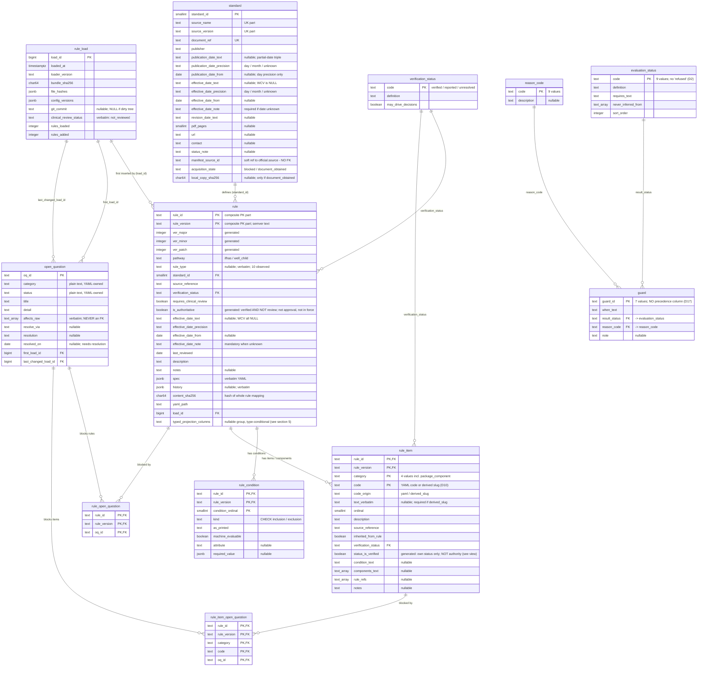
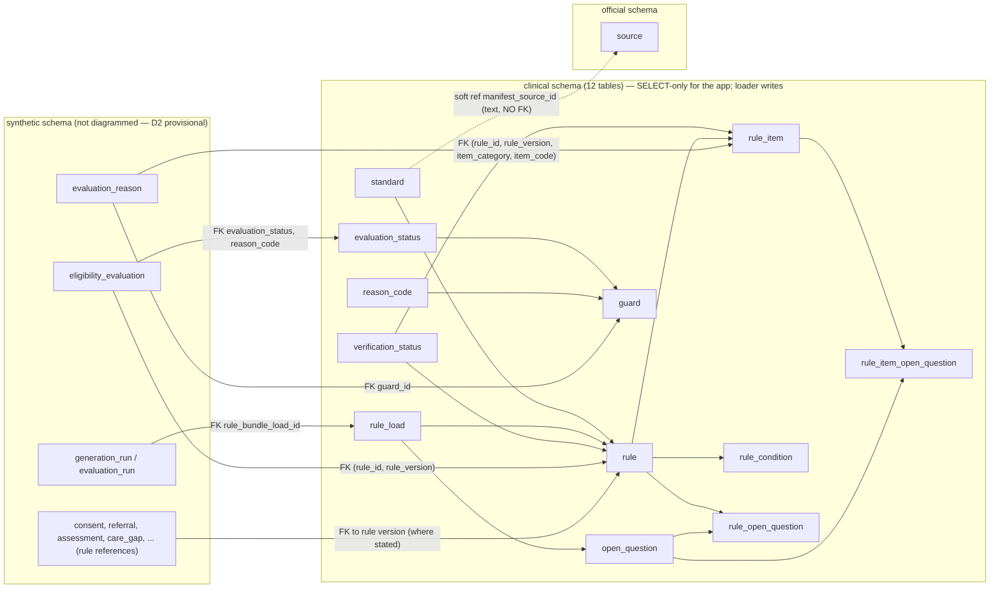

# PulseReach — `clinical` schema ERD

**Source of truth:** [`../phase-3-database-design.md`](../phase-3-database-design.md) revision 2.5, §4 (tables), §2.1 (schema boundaries).
**Scope:** the twelve approved `clinical` tables (D16 approved the four additions: `rule_load`, `verification_status`, `guard`, `rule_item_open_question`). Design only — no DDL, models or migrations exist.
**Status:** DRAFT. **Nothing in this schema is clinically validated** (`clinical_review_status = 'not_reviewed'`). The YAML in `data-pipeline/rules/` is the only source of truth; the database is a loaded, append-only copy (R-C1, R-C2). No clinical, legal or governance approval is claimed.

Views (`v_rule_current`, `v_rule_authority`, `v_rule_item_effective_authority`) are not entities and are not drawn.

## 1. Legend

| Notation | Meaning |
|---|---|
| `\|\|` on the parent side | FK is **NOT NULL** — exactly one parent |
| `\|o` on the parent side | FK is **nullable** |
| `o{` | Zero or many children |
| `PK` / `FK` / `UK` | Primary key / foreign key / unique constraint |

## 2. Entity-relationship diagram

## 3. Relationship register

| # | Parent (1) | Child (N) | FK column(s) | Nullable? | Cardinality | Notes |
|---|---|---|---|---|---|---|
| 1 | `standard` | `rule` | `standard_id` | No | 1 ─ N | Resolved by loader from `source_name` + `source_version` |
| 2 | `rule_load` | `rule` | `load_id` | No | 1 ─ N | The load that **first inserted** that version |
| 3 | `rule_load` | `open_question` | `first_load_id` | No | 1 ─ N | |
| 4 | `rule_load` | `open_question` | `last_changed_load_id` | No | 1 ─ N | |
| 5 | `verification_status` | `rule` | `verification_status` | No | 1 ─ N | |
| 6 | `verification_status` | `rule_item` | `verification_status` | No | 1 ─ N | The item's **own** status only; effective authority also requires the parent rule to be authoritative (view `v_rule_item_effective_authority`, §7) |
| 7 | `rule` | `rule_condition` | `(rule_id, rule_version)` | No | 1 ─ N | Composite FK |
| 8 | `rule` | `rule_item` | `(rule_id, rule_version)` | No | 1 ─ N | Composite FK |
| 9 | `rule` | `rule_open_question` | `(rule_id, rule_version)` | No | 1 ─ N | Association half |
| 10 | `open_question` | `rule_open_question` | `oq_id` | No | 1 ─ N | Association half |
| 11 | `rule_item` | `rule_item_open_question` | `(rule_id, rule_version, category, code)` | No | 1 ─ N | Association half; composite FK |
| 12 | `open_question` | `rule_item_open_question` | `oq_id` | No | 1 ─ N | Association half |
| 13 | `evaluation_status` | `guard` | `result_status` | **Not stated** (see §9 #2) | 1 ─ N | |
| 14 | `reason_code` | `guard` | `reason_code` | **Not stated** (see §9 #2) | 1 ─ N | |

All FKs `ON DELETE/UPDATE RESTRICT`; no `CASCADE` (§2.2).

### 3.1 One-to-one relationships

None. (A `rule_version` row is not 1:1 with anything; `rule_load` ↔ `rule` is 1 ─ N.)

### 3.2 Many-to-many relationships (resolved by association tables)

| Relationship | Association table | Composite PK |
|---|---|---|
| `rule` ↔ `open_question` | `rule_open_question` | `(rule_id, rule_version, oq_id)` |
| `rule_item` ↔ `open_question` | `rule_item_open_question` | `(rule_id, rule_version, category, code, oq_id)` |

Both are derived from each rule's / item's own `open_question_ids` (validated by the loader) — **never** from the YAML `affects` field, which is heterogeneous. `open_question.affects_raw` is stored as text array only and is not an FK.

## 4. Unique constraints and composite keys

| Table | Key / constraint | Notes |
|---|---|---|
| `standard` | PK `standard_id`; `UNIQUE (source_name, source_version)`; `UNIQUE (document_ref)` | |
| `rule_load` | PK `load_id` | |
| `verification_status`, `evaluation_status`, `reason_code` | PK `code` | Lookup tables, not ENUMs |
| `guard` | PK `guard_id` | |
| `open_question` | PK `oq_id` | Upserted per load (current state) |
| `rule` | **PK `(rule_id, rule_version)`** | Append-only; `content_sha256` mismatch on an existing key fails the load |
| `rule_condition` | **PK `(rule_id, rule_version, condition_ordinal)`**; `CHECK (kind IN ('inclusion','exclusion'))` (CD-4) | 5 `inclusion` + 3 `exclusion` today; exclusion evaluation semantics pending (OC-4) |
| `rule_item` | **PK `(rule_id, rule_version, category, code)`** | `code` for IFHAS components is a derived slug (D10); the raw string is never the key |
| `rule_open_question` | **PK `(rule_id, rule_version, oq_id)`** | |
| `rule_item_open_question` | **PK `(rule_id, rule_version, category, code, oq_id)`** | |

Child-table FKs reference the **full** parent composite key, so a child row is bound to one specific rule *version*, never "the latest".

## 5. `rule` typed projection columns (collapsed in the diagram)

To keep the diagram readable, the nullable, type-conditional projection columns of `clinical.rule` are shown as one line (`typed_projection_columns`). They are all in §4.2 `rule` and are **not** separate entities: `package_name`, `package_group`, `age_min_years`, `age_max_years`, `age_as_printed`, `sexes`, `frequency_type`, `interval_value`, `interval_unit`, `visit_number`, `visit_id`, `recommended_age_months`, `age_band`, `instrument`, `score_min`, `score_max`, `timing_value`, `timing_unit`, `timing_reference_event`, `gate_attribute`. They are convenience copies of `spec`, asserted equal to it by a load test (R-C4).

## 6. Nullable relationships — summary

Every FK **within** `clinical` is NOT NULL, except the two `guard` FKs whose nullability the design does not state (§9 #2). All genuinely optional links are expressed by the **absence of a row** in an association table (`rule_open_question`, `rule_item_open_question`), not by a nullable FK. Within `rule`, nullable *non-key* attributes (projections, effective date triple) are not relationships.

## 7. Provenance relationships

| Provenance question | Path |
|---|---|
| Which loader run inserted this rule version? | `rule.load_id → rule_load` (bundle hash, per-file hashes, config versions, git commit, loader version) |
| Which standard and page does it come from? | `rule.standard_id → standard`; `rule.source_reference` (section / appendix / PDF page) |
| Is the original YAML preserved? | `rule.spec`, `rule.history` (verbatim JSONB) + `rule.content_sha256` + `rule.yaml_path` |
| When did an open question first appear / last change? | `open_question.first_load_id`, `last_changed_load_id → rule_load` |
| Is the standard document actually held? | `standard.acquisition_state` (`blocked` for both today) + `local_copy_sha256` (only if `document_obtained`); soft pointer `manifest_source_id` to `official.source` |
| Is a rule authoritative? | **Derived**, never set: `rule.is_authoritative = (verification_status = 'verified' AND NOT requires_clinical_review)`. **Authoritative = a faithful, source-checked transcription of a published standard that is not flagged for review. It is not clinical approval and not confirmation that the standard is in force** (design R-C8). A proposed third condition (no open `blocks_rule` question link) is **not** part of the formula (CD-2 pending, OC-1) |
| Is an item authoritative? | **Not by its own column.** `rule_item.status_is_verified` records the item's own status only. `effective_authority = status_is_verified AND parent rule.is_authoritative`, exposed by the **view** `v_rule_item_effective_authority` (CD-1). Not a table; the 12-table count is unchanged |

## 8. Schema boundaries

| Boundary rule (§2.1) | Effect on this ERD |
|---|---|
| `synthetic → clinical` allowed | Inbound arrows only, drawn above |
| `clinical → synthetic` never | No outbound FK from any of the 12 tables |
| `clinical ↔ official` no FK | `standard.manifest_source_id` is a **soft** text reference (loader test), shown dotted |

The `synthetic` side is shown only as inbound references because D2 keeps the synthetic ERD pending. Which `synthetic` tables reference `rule` / `rule_item` beyond those named explicitly in §5.3 and §5.1 is **not re-derived here** (see §9 #6).

## 9. Unresolved relationships and constraints

1. **Cross-table rules enforced outside FKs:** "a rule with a non-machine-evaluable condition has `requires_clinical_review`" and "an unresolved item must reference ≥ 1 open question" span tables, so they are loader validations + tests (optionally deferred constraint triggers). Not shown as relationships.
2. **`guard.result_status` / `guard.reason_code` nullability** is not stated in §4.2 (both are listed as FKs, no "Null" column). The ERD draws them as mandatory (`||`). If a guard may have no `reason_code`, change to `|o`. Needs owner confirmation; no design change made.
3. **Guard precedence** is deliberately absent (D17 open). No ordering relationship among guards exists.
4. **`open_question.category` / `status`** and **`rule.rule_type`** are unconstrained text (YAML-owned vocabularies, validated by the loader) — no lookup-table FKs.
5. **IFHAS `rule_item.code`** is a derived slug (D10 recommended, not approved); a move to explicit YAML codes is a data migration of `code`, which also appears in the `rule_item_open_question` composite key.
6. **Inbound references from `synthetic`** are known only to the level stated in §4.2 ("evaluations, referrals, consent scope, assessments") and §5.1/§5.3. Their exact FK sets are for the synthetic ERD, which is **not** created here.
7. **`rule.load_id`** records only the load that *first inserted* a version; later loads that re-confirm an identical version are visible only via `rule_load.rules_loaded` vs `rules_added`, not through a relationship.
8. **Append-only enforcement** (no UPDATE/DELETE on `rule`, `rule_condition`, `rule_item`) is by role privileges and trigger — not expressible in an ERD.

## 10. Discrepancies between this ERD and the canonical design

| # | Discrepancy | Handling |
|---|---|---|
| 1 | The twenty nullable projection columns of `rule` are collapsed into one placeholder line. | Presentation only; listed in full in §5. |
| 2 | `text_array` / `char64` are Mermaid-safe renderings of `TEXT[]` / `CHAR(64)`. | Presentation only. |
| 3 | `guard.result_status` / `reason_code` drawn as mandatory although §4.2 does not state nullability. | Flagged in §9 #2. |
| 4 | Mermaid cannot show generated columns, CHECKs, append-only triggers, views or the `standard.manifest_source_id` soft reference as a line in the `erDiagram`. | Shown as column comments, in §4/§7, and as a dotted line in the boundary flowchart. |
| 5 | `rule_item.is_authoritative` renamed `status_is_verified` (CD-1); the parent-aware `v_rule_item_effective_authority` view is described in §7 but not drawn (views are not entities). | Matches design §4.2. |
| 6 | The proposed link `effect` (CD-2) is **not** drawn: it is proposed, unapproved, and not in the canonical column lists. | Open — clinical/rules owner (OC-1). |

No tables or relationships were added beyond the canonical design, and none of the twelve tables was omitted.
