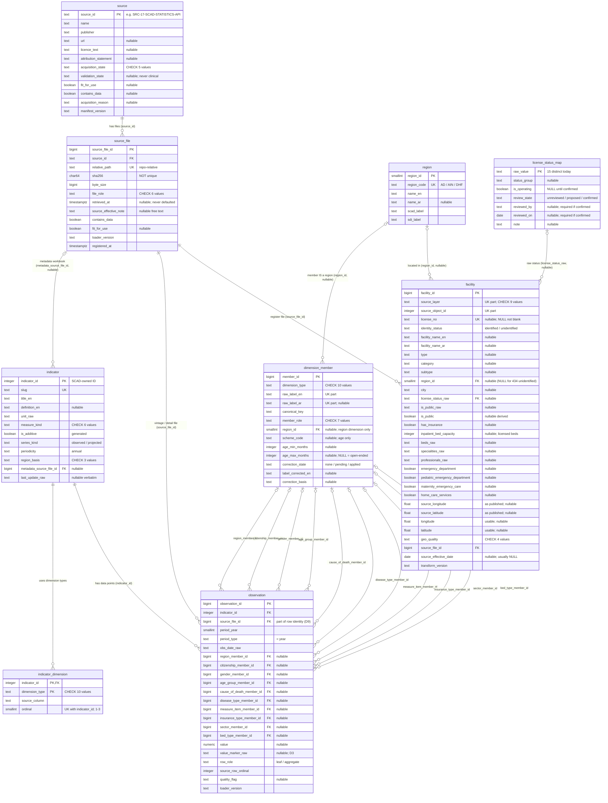
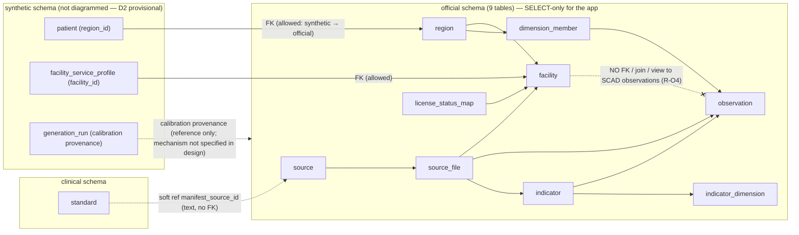

# PulseReach — `official` schema ERD

**Source of truth:** [`../phase-3-database-design.md`](../phase-3-database-design.md) revision 2.3, §3 (tables), §2.1 (schema boundaries).
**Scope:** the nine approved `official` tables. Design only — no DDL, models or migrations exist.
**Status:** DRAFT. Reflects the canonical design; nothing here is clinically, legally or governance approved. Recommendations D6 and D7 (and D11, which affects `synthetic`) await owner confirmation.

Excluded on purpose: `official.working_calendar` (**conditional on D12**, not one of the nine; no relationships — it would be a standalone lookup). Views (`v_observation_*`, `v_facility_usable`, …) are not entities and are not drawn.

## 1. Legend

| Notation | Meaning |
|---|---|
| `PK` / `FK` / `UK` | Primary key / foreign key / unique constraint (a column may carry several) |
| `\|o` on the parent side | The FK is **nullable** — the child may have no parent |
| `\|\|` on the parent side | The FK is **NOT NULL** — exactly one parent |
| `o{` | Zero or many children |
| Solid line | Enforced foreign key |
| Dotted line (flowchart only) | Soft / loader-asserted reference, no constraint |

There are **no one-to-one** relationships and **no direct many-to-many** relationships in `official`. The only many-to-many-like structure is *indicator ↔ dimension type*, which is carried by the `indicator_dimension` association table (and `dimension_member` is shared across indicators by label, not by FK).

## 2. Entity-relationship diagram

## 3. Relationship register

| # | Parent (1) | Child (N) | FK column(s) | Nullable? | Cardinality | Delete rule |
|---|---|---|---|---|---|---|
| 1 | `source` | `source_file` | `source_id` | No | 1 ─ N | RESTRICT |
| 2 | `source_file` | `indicator` | `metadata_source_file_id` | **Yes** (15 indicators have no workbook) | 0..1 ─ N | RESTRICT |
| 3 | `source_file` | `observation` | `source_file_id` | No | 1 ─ N | RESTRICT |
| 4 | `source_file` | `facility` | `source_file_id` | No | 1 ─ N | RESTRICT |
| 5 | `indicator` | `indicator_dimension` | `indicator_id` | No | 1 ─ N (0–3 per indicator) | RESTRICT |
| 6 | `indicator` | `observation` | `indicator_id` | No | 1 ─ N | RESTRICT |
| 7 | `region` | `dimension_member` | `region_id` | **Yes** (set only where the member *is* a region) | 0..1 ─ N | RESTRICT |
| 8 | `region` | `facility` | `region_id` | **Yes** (NULL for the 434 unidentified rows) | 0..1 ─ N | RESTRICT |
| 9 | `license_status_map` | `facility` | `license_status_raw` | **Yes** | 0..1 ─ N | RESTRICT |
| 10–19 | `dimension_member` | `observation` | ten `*_member_id` columns | **All ten nullable** (`NULL` = dimension not applicable to the indicator) | 0..1 ─ N each | RESTRICT |

No `CASCADE` anywhere (§2.2).

### 3.1 Many-to-many (via association tables)

| Relationship | Association table | Composite key |
|---|---|---|
| `indicator` ↔ dimension type (0–3 per indicator, 10 types) | `indicator_dimension` | PK `(indicator_id, dimension_type)`; `UNIQUE (indicator_id, ordinal)` |

`indicator_dimension.dimension_type` is a `CHECK`-constrained text, **not** an FK to a table (there is no dimension-type table in the approved set). `dimension_member` is related to `indicator` only *indirectly*, through `observation`.

## 4. Unique constraints and composite keys

| Table | Constraint | Notes |
|---|---|---|
| `source` | PK `source_id` | |
| `source_file` | `UNIQUE (relative_path)`; index `(source_id, file_role)`; index `(sha256)` | `sha256` is deliberately **not** unique |
| `region` | PK `region_id`; `UNIQUE (region_code)` | |
| `indicator` | PK `indicator_id`; `UNIQUE (slug)` | |
| `indicator_dimension` | **PK `(indicator_id, dimension_type)`**; `UNIQUE (indicator_id, ordinal)` | composite PK |
| `dimension_member` | `UNIQUE NULLS NOT DISTINCT (dimension_type, raw_label_en, raw_label_ar)` | PostgreSQL 15+ (compose pins 16) |
| `observation` | **Partial unique** `UNIQUE NULLS NOT DISTINCT (indicator_id, source_file_id, period_year, <10 member columns>) WHERE quality_flag IS NULL` | Duplicate-key rows (indicator 3422) load with `quality_flag = 'duplicate_key_conflict'` and fall outside the index (D5) |
| `facility` | `UNIQUE (source_layer, source_object_id)`; `UNIQUE (license_no)` (NULLs distinct) | `OBJECTID` is unique only within a layer |
| `license_status_map` | PK `raw_value` | |

## 5. Provenance relationships

| Provenance chain | Path |
|---|---|
| Every observation → file → publisher | `observation.source_file_id → source_file.source_id → source` |
| Every facility → file → publisher | `facility.source_file_id → source_file.source_id → source` |
| Indicator definition → metadata workbook | `indicator.metadata_source_file_id → source_file` (nullable) |
| Vintage | `source_file.retrieved_at` is a **retrieval** timestamp; `facility.source_effective_date` and `source_file.source_effective_note` hold publisher dates **only if stated** (D15) |
| As-published vs usable coordinates | `facility.source_longitude/latitude` (verbatim) vs `longitude/latitude` (usable, only when `geo_quality IN ('ok','swapped_repaired')`) |
| Original vs corrected labels | `dimension_member.raw_label_*` (verbatim) vs `label_corrected_en` + `correction_basis` (only when `correction_state = 'applied'`) |
| Loader/transform lineage | `observation.loader_version`, `facility.transform_version`, `source_file.loader_version` |

## 6. Schema boundaries

| Boundary rule (§2.1) | Effect on this ERD |
|---|---|
| `synthetic → official` allowed | Inbound arrows only: `patient.region_id → region`, `facility_service_profile.facility_id → facility`, calibration provenance |
| `official → synthetic` never | No outbound FK in the diagram |
| `official ↔ clinical` no FK | `clinical.standard.manifest_source_id` is a **soft** text reference to `source.source_id`, validated by a loader test |
| R-O4 | `facility` and `observation` are **intentionally unconnected** (SDI counts licences; SCAD counts facilities) |

## 7. Nullable relationships — summary

Nullable FKs: `indicator.metadata_source_file_id`, `dimension_member.region_id`, `facility.region_id`, `facility.license_status_raw`, and all ten `observation.*_member_id`. Every other FK in the schema is NOT NULL.

## 8. Unresolved relationships and constraints

1. **`dimension_type` consistency is not enforced by an FK.** Each `observation.*_member_id` must point at a member of the matching `dimension_type`; the design states this as a loader assertion + test, with an *optional* generated-column composite FK. Not drawn as a constraint.
2. **No `dimension_type` lookup table.** `indicator_dimension.dimension_type` and `dimension_member.dimension_type` repeat the same `CHECK` list; consistency between them is by convention.
3. **Source → file cardinality** (`dataset_obtained` / `document_obtained` ⇒ ≥ 1 `source_file`) is a deferred constraint trigger / loader test, not an FK (drawn as 1 ─ N only).
4. **Detail file ↔ indicator.** `observation.source_file_id` should be a detail file *of the same indicator*; there is deliberately no `detail_source_file_id` on `indicator`, so this is a loader assertion (§6.3), not a constraint.
5. **Leaf/aggregate reconciliation** (leaves sum to aggregate) is a load test, not a constraint.
6. **`working_calendar`** exists only if D12 is decided that way; omitted here.
7. **D6 / D15** change column types and provenance content on `facility`, not relationships.
8. **`license_status_map`**: the loader inserts any unseen raw value as `unreviewed` so the FK holds; the 15 current values are not yet reviewed (D13).

## 9. Discrepancies between this ERD and the canonical design

| # | Discrepancy | Handling |
|---|---|---|
| 1 | §3.2 `source_file` says "1 ─ N `indicator` (detail/metadata)", but §3.3 `indicator` has **only** `metadata_source_file_id` (the detail file is deliberately a property of each `observation`). | ERD follows the column definitions (§3.3). §3.2's relationship note is loose wording; **not edited** in the canonical doc beyond this note — flagged for the owner. |
| 2 | Ten `observation → dimension_member` relationships are drawn as ten separate lines (one per column). | Presentation only; matches the ten FK columns. |
| 3 | `char(64)` is rendered `char64` and `double precision` as `float` because Mermaid's type token does not accept parentheses/spaces. | Presentation only. |
| 4 | Generated columns (`is_additive`) and CHECK constraints are shown only as comments. | Presentation only; §3 remains authoritative. |
| 5 | Mermaid cannot express "partial unique index" or `NULLS NOT DISTINCT`; these are listed in §4 instead. | Presentation only. |

No tables or relationships were added beyond the canonical design, and none of the nine tables was omitted.
