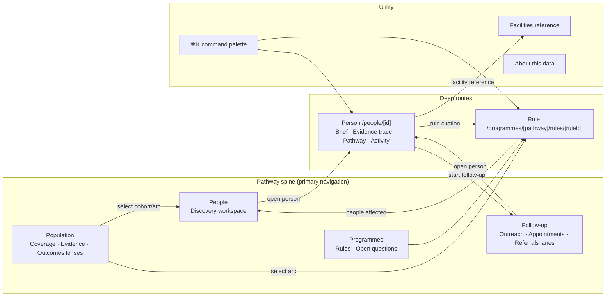
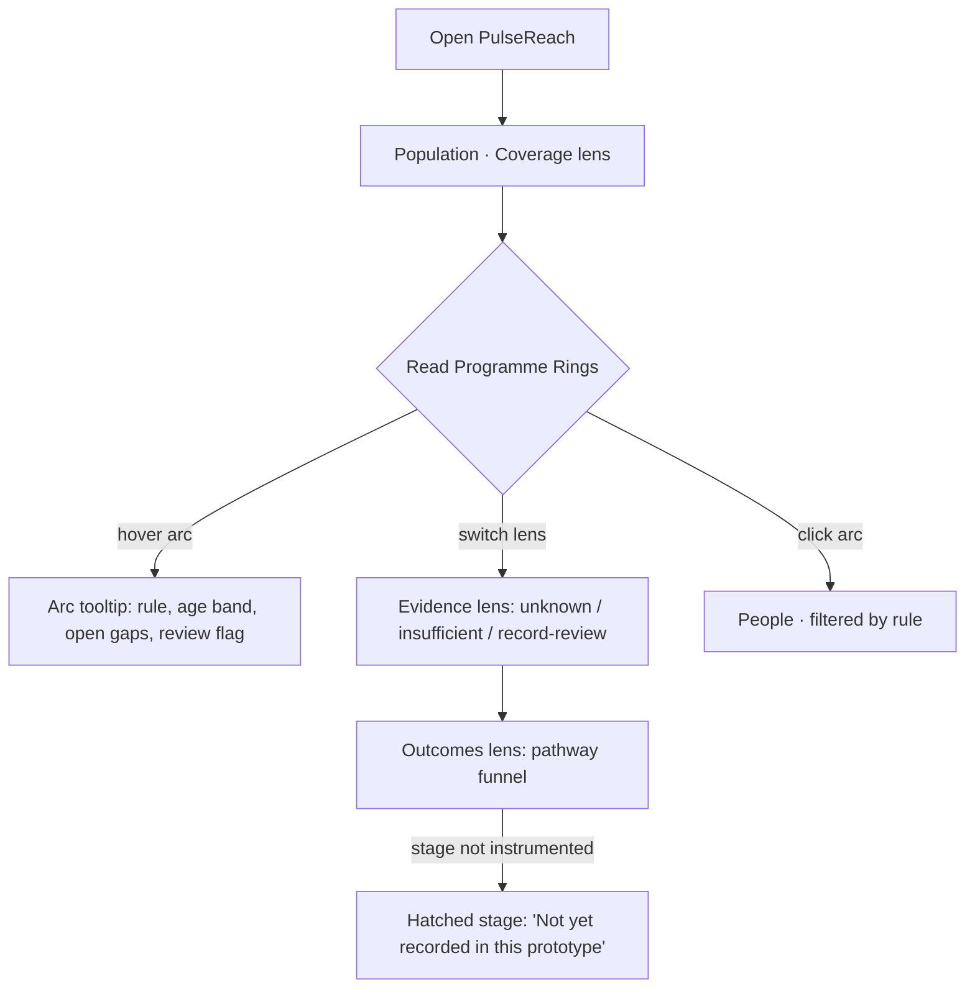
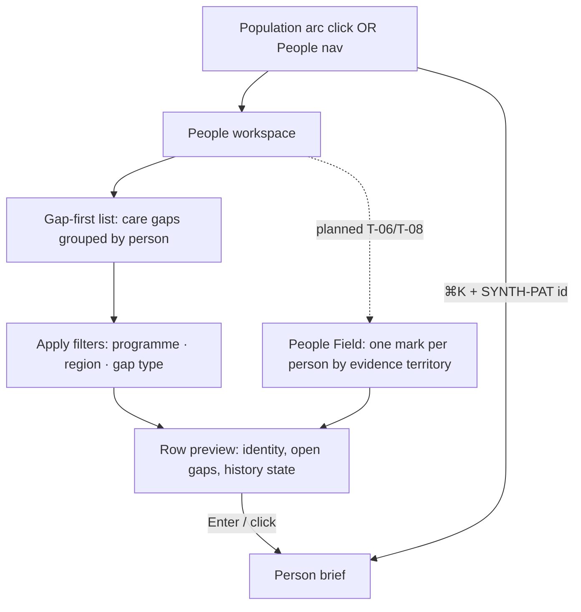
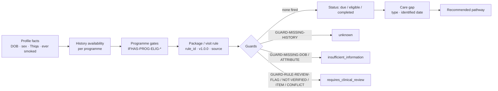
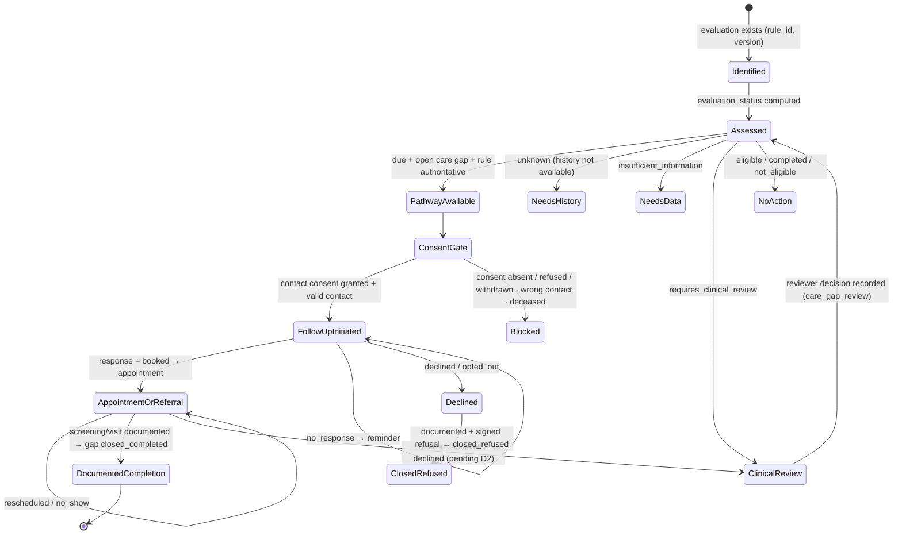
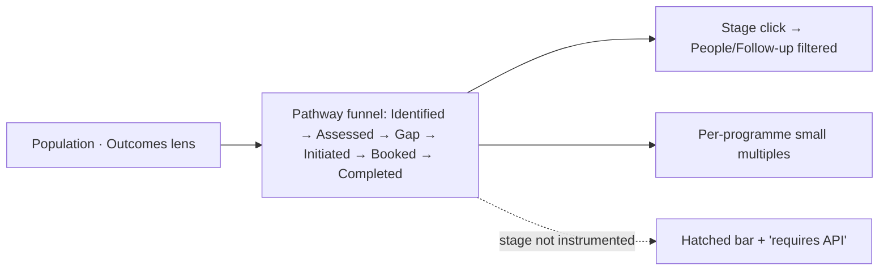

# PulseReach — Frontend UI/UX Design Proposal

**Type:** design discovery and planning only. No UI code, packages or backend changes are part of this document.
**Prepared:** 2026-11-18 · **Repository state inspected:** branch `main`, HEAD `c4f009d` ("Backend report"), working tree clean.
**Status:** PROPOSED — for review and approval before frontend implementation starts.

> **Working agreement (confirmed by the product owner, 2026-11-18)**
> - **Backend** is completed by a separate developer. The frontend builds against the API contract in §12 and §14.1 and does not change backend code.
> - **Sequence:** (1) finalise and implement this design → (2) AI layer (§14.2) → (3) connect follow-up workflows as backend endpoints land.
> - **Questions:** all unresolved questions live in this document (§15.2 register) instead of being raised ad hoc. Answers are recorded in the register's *Answer* column.

> **Governance reminder.** Every person shown in PulseReach is synthetic (`is_synthetic: true`, `SYNTH-` identifiers, names suffixed `(synthetic)`). Clinical rules are a transcription of published Abu Dhabi DoH standards for engineering use (`clinical_review_status: not_reviewed`). Nothing in this design may imply clinical validation, real patient operations, real outreach or real appointments.

---

## Contents

1. Product and problem-statement understanding
2. UX design principles
3. Three alternative visual concepts
4. Comparison and recommended concept
5. Final visual identity and design tokens
6. Information architecture
7. Detailed user journeys
8. Screen-by-screen wireframe descriptions
9. Graphics, icons and visualisation strategy
10. Reusable component architecture
11. Responsive and accessibility considerations
12. Backend API and data dependencies
13. Clinical and data-integrity safeguards
14. Phased implementation roadmap (incl. 14.1 backend handoff contract, 14.2 AI-layer design hooks)
15. Important design decisions and open-question register
16. References and inspiration

---

## 1. Product and problem-statement understanding

### 1.1 Context

- **Challenge:** Future Health Digital Innovation Challenge 2026 (Abu Dhabi, via Hack2skill), focus area **Population Health**, theme **Precision Prevention and Screening** (`docs/data-sources.md` §C, Source 9).
- **Judging criteria (verified from the event page in `docs/data-sources.md`):** health impact · technical depth · working solution and demo quality · **responsible AI and data governance** · scalability · commercial viability. The rules also require "safe triage with clinical boundaries and **human oversight**" and a demonstrable, safe prototype.
- **Implication for design:** governance is part of the score, so it should not be hidden in a footer. How the product shows what it does not know is part of its value, and the UI should make it visible.

### 1.2 Value proposition and the four verbs

> "Identify who needs preventive care, understand why, connect them to the right pathway and measure whether care was completed."

The design is organised around these four verbs:

| Verb | Product question | Primary surface |
|---|---|---|
| **Identify** | Who has a documented preventive-care need, and where is the evidence incomplete? | Population, People |
| **Understand** | Why was this person identified, according to which rule and version, and what is missing? | Person profile, Evidence trace |
| **Connect** | Which pathway applies, and can we follow up with consent? | Care pathway, Follow-up |
| **Measure** | Is documented follow-up progressing, and is care completed? | Population → Outcomes lens |

### 1.3 What the product actually knows (from the repository)

| Fact | Source | Design consequence |
|---|---|---|
| 2 programmes: **IFHAS** adult screening (29 rules: 20 screening packages, 4 programme-eligibility, 5 workflow-timing) and **Well-Child Visits** (25 rules: 14 visit schedules, 4 developmental tiers, 2 follow-up windows, 2 policies, 3 programme/timing) | `data-pipeline/rules/*.yaml`, `docs/clinical-rules.md` | Programme visualisations are built from real rule structure (packages, age bands, visit ages), not decorative segments |
| 54 rules, 47 authoritative, 7 review-flagged, 3 unresolved; 249 rule items; 23 open questions | `GET /api/v1/dashboard/summary` → `rules_summary` | Rule governance appears at programme level as well as in individual traces |
| Evaluation statuses: `eligible`, `not_eligible`, `due`, `upcoming`, `completed`, `unknown`, `insufficient_information`, `requires_clinical_review`. `overdue` is defined but **never produced** | `status_definitions.yaml`, audit §8 | The UI has no "overdue" state, no red "late" styling and no lateness timers for Well-Child |
| 7 guards (`GUARD-MISSING-DOB`, `GUARD-MISSING-ATTRIBUTE`, `GUARD-MISSING-HISTORY`, `GUARD-CONFLICTING-RECORDS`, `GUARD-RULE-NOT-VERIFIED`, `GUARD-RULE-REVIEW-FLAG`, `GUARD-ITEM-UNRESOLVED`) and 9 reason codes | `status_definitions.yaml` | The evidence trace shows guards as named, first-class nodes |
| Care-gap types: `no_documented_screening`, `interval_elapsed`, `partial_completion`, `referral_not_initiated`, `visit_not_attended`; statuses `open`, `closed_completed`, `closed_refused`, `suppressed`, `superseded` | `CareGapOut`, `models/synthetic.py` | A "care gap" is a rule-derived, documented gap. It is never labelled "risk" |
| History availability per pathway: `available`, `partial`, `not_available` | `PatientSummaryOut.history_by_pathway` | "Evidence completeness" is a visible dimension of every person |
| Consent types `contact`, `data_processing`, `ai_assisted_prioritisation`, `screening_participation`; states `granted`, `withdrawn`, `refused` (absence ≠ granted) | `models/synthetic.py` (`consent`) | Consent is shown as a gate on the pathway, not as a checkbox |
| Workflow entities in the DB schema: `outreach_event` (invitation, reminder, recall_positive_result, recall_insufficient_result, referral_follow_up; responses booked/declined/opted_out/wrong_contact/no_response), `appointment` (scheduled, attended, no_show, cancelled_by_patient, cancelled_by_facility, rescheduled), `referral` (pending, initiated, completed, declined, cancelled), `care_gap_review` (confirmed, priority_overridden, dismissed) | `models/synthetic.py` | The follow-up design uses these exact vocabularies, but **none are exposed by the API yet** (§12) |
| Synthetic data: 550 people (411 adults / 139 children), 3 regions (Abu Dhabi, Al Ain, Al Dhafra), fictional district labels, **no coordinates** | generator, `official_loader/parse.py` `REGIONS` | Region-level geography only. No street-level or map-pin claims for people |
| 2,985 "usable" official SDI facilities; service capability is a **simulated overlay produced by placeholder logic** (D-7); no coordinates in the API | `GET /api/v1/facilities`, audit D-6/D-7 | Facilities are a *reference register*, not a routing engine |
| `priority_score` is a constant `0.78` attributed to a non-existent model | audit D-5 | **No priority score or risk score is ever displayed** |
| Explanation service uses a deterministic template only (`generation_mode: deterministic_fallback`); no LLM is wired | audit §10 | The explanation panel is labelled by `generation_mode` and always sits next to the structured trace |

### 1.4 Four concepts that must never be merged visually

| Concept | Data source | Visual vocabulary |
|---|---|---|
| **Programme eligibility** ("is this person in scope of this rule?") | `evaluation_status ∈ {eligible, not_eligible}` | Ring glyph / dash glyph; never coloured as urgent |
| **Documented care gap** ("a verified rule says a screening/visit is not documented") | `care_gaps[]`, `evaluation_status = due` | Filled terracotta node + gap-type label |
| **Evidence state** ("we cannot tell") | `unknown`, `insufficient_information`, `history_by_pathway` | Dashed / broken-outline glyphs, hatch textures |
| **Operational ordering** ("which item does the team handle next?") | Not supported today (constant score) | Not shown. A transparent, non-clinical ordering rule is an open question (§15) |
| *(Out of MVP)* **Elevated health risk** | No data source, no rule (`phase-3-reconciliation-report.md` §9.2 row 1) | Not shown anywhere. No risk scores, percentages or heatmaps |

### 1.5 Users

| User | Role | Main need |
|---|---|---|
| **Population-health operator** (primary) | Programme coordinator in a preventive-care team | See where documented needs and evidence gaps sit, then work a queue of people |
| **Clinical reviewer** (secondary) | Licensed professional who owns `requires_clinical_review` cases | Read the evidence trace quickly and see exactly which rule, version, guard and open question is involved |
| **Programme / governance lead** (secondary) | Owns rules, KPIs, open questions | Rule provenance, verification status, open-question register |
| **Hackathon judge** (demo audience) | Evaluates impact and governance in about 5 minutes | Understand the story without training: Identify → Understand → Connect → Measure, with honesty visible |

---

## 2. UX design principles

1. **Say what is known, and what is not, in the same place.** Every count, node and status carries its evidence state. Unknowns are drawn with outlines and hatches, never removed and never shown as zero.
2. **Rule first, person second.** Every person-level claim links to a `rule_id` + `rule_version` + source citation in at most one click.
3. **Shape before colour.** Every status has a unique glyph shape *and* a text label. Colour is the third signal.
4. **No invented urgency.** There is no overdue state, countdown, red alarm or risk gradient. Terracotta means "documented gap", not "danger".
5. **Distinguish rule-originated review from record-originated review.** `rule_requires_clinical_review` / `rule_unresolved` are properties of the *rule* and affect everyone the rule touches. `conflicting_records` / `rule_item_unresolved` are properties of the *person's record*. The UI never counts the first kind as "people needing review" (§13.3).
6. **Simulation is visible as a texture.** Synthetic, simulated and placeholder content share one motif, a diagonal **synthetic hatch**, so the label is visible even in a screenshot.
7. **Show progress only where it is recorded.** Pathway stages with no backend support are drawn as hatched, inactive stages labelled "Not yet recorded in this prototype". They are not filled with mock data.
8. **Editorial clarity for reading, instrument density for scanning.** Long-form evidence is set on warm paper with serif headings. Population scanning happens on a dark "observatory" surface with dense, quiet data marks.
9. **Two clicks from population to person, one click from person to rule.**
10. **The LLM only describes.** Any generated text sits beside the deterministic result, carries its `generation_mode` and has no controls that could change a status.

---

## 3. Three alternative visual concepts

The three concepts differ in **composition, interaction model and spatial metaphor**, not only in palette.

### Concept A — "Population Constellation"

| Aspect | Specification |
|---|---|
| **Product personality** | Exploratory, spatial, calm, slightly scientific. Like an observatory looking at a population. |
| **Visual inspiration** | Star charts, network-science figures, particle visualisations, planetarium interfaces. |
| **Palette** | Night `#0A1418` · Deep field `#10222A` · Grid line `#1E3640` · Starlight text `#E8F0EE` · Dim text `#8FA6A0` · Primary accent Aurora `#5ED1B0` · Secondary accent Nebula `#9C8CF2` · Due `#F08A6C` · Completed `#6CCB8F` · Review `#B89AF0` · Unknown `#9AA4A0` |
| **Typography** | Display: *Space Grotesk* 500. Body: *Geist Sans*. Data/IDs: *Geist Mono*. |
| **Icon style** | Thin 1.25 px stroke, circular containers, "orbit" metaphors. |
| **Graphic style** | One full-bleed canvas: each synthetic person is a point; points cluster into cohort "galaxies" (programme × evidence state). Lines appear only for real relationships (person → rule → gap; child → guardian). |
| **Data-vis approach** | Force-directed or packed-cluster layout of all 550 people; semantic zoom (population → cohort → person); cohort halos sized by count. |
| **Navigation model** | Canvas-first. A floating "lens" switcher (Programme / Evidence / Follow-up / Region) re-clusters the same points. Search is the only other navigation. Modules open as right-hand drawers over the canvas. |
| **Dashboard composition** | 100 % canvas plus a floating legend, a bottom "cohort strip" of selected cluster counts, and a top-left synthetic banner. |
| **Person profile** | Zooming into a point opens a radial "person orbit": rules as satellites at distance = rule type, glyph = status. |
| **Follow-up workflow** | Points carry trailing "orbit trails" for follow-up stages; selecting a cohort opens a drawer queue. |
| **Strengths** | Memorable in a demo; shows that people sit inside overlapping programme and evidence states; strong "population" feeling. |
| **Limitations** | Weak for reading rule provenance and dense text; force layouts are non-deterministic, so the same data can look different and positions can be misread; hard to make fully accessible; risk of decorative graphics; 550 points is small enough to look sparse. |

### Concept B — "Prevention Instrument"

| Aspect | Specification |
|---|---|
| **Product personality** | Analytical, precise, dense. Like a flight instrument or lab analyser. |
| **Visual inspiration** | Avionics displays, laboratory analyser UIs, engineering dashboards with radial gauges, Swiss information design. |
| **Palette** | Graphite `#15181A` · Panel `#1D2124` · Panel-raised `#252A2E` · Hairline `#353B40` · Text `#F2F4F3` · Muted `#9BA3A0` · Primary accent Signal lime `#C6F24E` · Secondary accent Cyan `#4CC9E0` · Due `#FF8A5B` · Completed `#57D38C` · Review `#C29BFF` · Unknown `#8E979A` |
| **Typography** | Display/heading: *IBM Plex Sans Condensed* 600. Body: *IBM Plex Sans*. Data: *IBM Plex Mono* with tabular numerals. |
| **Icon style** | 1.5 px stroke, squared terminals, technical glyphs. |
| **Graphic style** | Concentric **programme rings**: the outer ring is IFHAS packages (20 arcs by age band), the inner ring is Well-Child visits (14 arcs by visit age), with a centre hub of rule governance. Each arc's fill is a stacked status distribution. |
| **Data-vis approach** | Radial stacked arcs, sparkline-style micro-bars, a status "spectrum bar" per rule, and tight small multiples. |
| **Navigation model** | Top command bar plus a **tri-pane layout**: left a collapsible filter stack, centre the instrument, right an inspector. Everything is keyboard-driven (⌘K). |
| **Dashboard composition** | Ring instrument centred at 560 px, flanked by inspectors; small multiples per region underneath. |
| **Person profile** | A "person dial": the same rings filtered to one person's applicable rules, plus an inspector list. |
| **Follow-up workflow** | A dense kanban-like lane grid with keyboard actions. |
| **Strengths** | Maps directly to the real rule structure (packages and visits); very information-dense; programme coverage is easy to read; scales by adding a ring per programme. |
| **Limitations** | Intimidating for judges and new users; radial charts are poor for exact comparison; dark-only density tires readers on long evidence text; looks like a "cockpit", which can read as automated decision-making rather than human oversight. |

### Concept C — "Editorial Health Intelligence"

| Aspect | Specification |
|---|---|
| **Product personality** | Considered, trustworthy, narrative. Like a high-quality health-policy publication that you can operate. |
| **Visual inspiration** | Long-form data journalism, policy briefs, scientific journals, museum wayfinding. |
| **Palette** | Paper `#F4F1EA` · Paper-raised `#FBFAF6` · Paper-sunken `#ECE7DC` · Rule `#D9D2C3` · Ink text `#14201F` · Secondary `#55605C` · Deep ink surface `#0E1A1F` · Primary accent Juniper `#0B6E5B` · Secondary accent Brass `#A8792B` · Due `#C4532F` · Completed `#276B43` · Review `#7B4BB7` · Unknown `#646C69` |
| **Typography** | Display: *Fraunces* (variable, optical size). Heading/body: *Geist Sans*. Data/IDs: *Geist Mono*. |
| **Icon style** | Lucide 1.5 px, used sparingly; numbered marginal annotations instead of decorative icons. |
| **Graphic style** | Asymmetric 12-column layouts with a wide reading column and a narrow **margin column** for annotations, provenance and footnotes; horizontal "pathway ribbons"; restrained dot-strip charts. |
| **Data-vis approach** | Annotated unit charts, ranked dot strips, horizontal ribbons, footnoted numbers ("¹ counts rule evaluations, not people"). |
| **Navigation model** | Top masthead with section names, like a publication; each module is a "chapter" with in-page anchors; the person profile reads like a case brief. |
| **Dashboard composition** | A headline statement ("Documented preventive-care gaps across 550 synthetic people"), one hero visual, then a sequence of annotated sections. |
| **Person profile** | A case brief: identity header, a "findings" section, the evidence trace as a numbered argument, footnoted rule citations in the margin. |
| **Follow-up workflow** | A ledger with dated entries and a pathway ribbon above. |
| **Strengths** | Best for explaining *why*; excellent for provenance and footnoted uncertainty; strongly differentiated from blue-and-white dashboards; high legibility; judges understand it immediately. |
| **Limitations** | Weaker for scanning large cohorts and operational queues; can feel slow for repetitive work; too much prose risks a "report" rather than a product. |

---

## 4. Comparison and recommended concept

### 4.1 Scored comparison (1 = weak, 5 = strong)

| Criterion | A Constellation | B Instrument | C Editorial |
|---|---|---|---|
| Communicates *precision* prevention (rule-level specificity) | 2 | 5 | 4 |
| Communicates *population* | 5 | 3 | 3 |
| Explains *why* (evidence, provenance) | 2 | 3 | 5 |
| Honesty about unknown/review states | 3 | 4 | 5 |
| Dense operational work (queues) | 2 | 5 | 3 |
| Accessibility | 2 | 3 | 5 |
| Distinctiveness vs generic dashboards | 5 | 4 | 4 |
| Demo legibility for judges in 5 minutes | 4 | 2 | 5 |
| Scales to more programmes | 3 | 5 | 4 |
| Feasible with current API | 2 | 3 | 4 |
| **Total** | **30** | **37** | **42** |

### 4.2 Recommendation — "Prevention Atlas" (C + B + a constrained part of A)

**Prevention Atlas** uses Concept C's editorial reading system as the base, Concept B's **programme rings** as the main coverage instrument, and a **deterministic** version of Concept A's population field (a "People Field" laid out on a fixed grid, with no physics simulation).

| Borrowed from | Element | How it is constrained |
|---|---|---|
| **C Editorial** | Warm paper reading surfaces, Fraunces headings, margin column for provenance and footnotes, case-brief person profile, numbered evidence argument | Prose is limited to headings, one-line findings and footnotes. Operational tables stay compact |
| **B Instrument** | Programme Rings (IFHAS outer, Well-Child inner) built from real rule structure; status spectrum bars; keyboard command palette | Rings appear on Population and Programme screens only; exact numbers sit beside every arc |
| **A Constellation** | People Field: one mark per synthetic person, grouped into evidence-state "territories"; relationship lines only for real links | Fixed grid layout (no force simulation), so the same data always looks the same; shown only after the person-level roll-up API exists (§12) |

**Why it best communicates precision prevention:** the main graphics are literally the rule set. Each ring arc is one IFHAS package or one Well-Child visit with its printed age band, so "precision" is visible as specificity: this rule, this version, this person.

**Why it suits population-health professionals:** the work has two modes, scanning many people and judging one case. The Atlas gives each mode its own surface: dark observatory for scanning, warm paper for reading and judging.

**How it differs from generic dashboards:** there is no left sidebar, no four-KPI row and no default blue theme. Navigation is a horizontal pathway spine. The hero visual is a rule-structured ring, not a line chart. Uncertainty is drawn, not hidden.

**How it supports dense information:** paper surfaces use a 12-column grid with a dedicated margin column, so provenance never pushes content down. Observatory surfaces use quiet small marks with exact numbers on hover or focus, and dense lists use 36 px rows with Geist Mono IDs.

**How it scales:** a new programme adds one concentric ring (Programme Rings), one programme chip colour and one spine filter. A new workflow stage adds one station to the pathway connector. Module count does not grow.

---

## 5. Final visual identity and design tokens

### 5.1 Surfaces: paper and ink

- **Paper** (default): reading, evidence, profile, rules, follow-up ledger.
- **Ink observatory**: the Population hero band, the People Field, programme rings, top navigation bar.
- Rule: a screen may have **one** ink band. Ink is used for overview, paper for detail. This pairing is how the Atlas looks distinct.

### 5.2 Colour tokens

All text pairs target WCAG 2.2 AA (≥ 4.5:1 for body text, ≥ 3:1 for large text and UI graphics). Approximate contrast ratios were computed against the stated background and must be re-checked with a contrast tool during implementation.

**Neutrals and surfaces**

| Token | HEX | Usage |
|---|---|---|
| `paper.base` | `#F4F1EA` | Main application background |
| `paper.raised` | `#FBFAF6` | Elevated surfaces: panels, popovers, the evidence card |
| `paper.sunken` | `#ECE7DC` | Wells, input backgrounds, inactive pathway stages |
| `paper.rule` | `#D9D2C3` | 1 px hairlines and table rules |
| `ink.base` | `#0E1A1F` | Top navigation bar, observatory bands |
| `ink.raised` | `#16262D` | Panels on ink |
| `ink.line` | `#243A43` | Grid lines and hairlines on ink |
| `text.primary` | `#14201F` | Primary text on paper (~15:1) |
| `text.secondary` | `#55605C` | Secondary text on paper (~6:1) |
| `text.tertiary` | `#6F7773` | Captions and footnotes; minimum 12 px (~4.6:1) |
| `text.onInk` | `#EEF2EE` | Primary text on ink |
| `text.onInkMuted` | `#A9B7B2` | Secondary text on ink (~8:1) |

**Accents**

| Token | HEX (paper / ink) | Usage |
|---|---|---|
| `accent.primary` "Juniper / Pulse mint" | `#0B6E5B` / `#5ED1B0` | Primary actions, focus ring, active spine station, links |
| `accent.secondary` "Brass" | `#A8792B` (graphic only) / `#D8B26A` | Editorial annotations, footnote markers, the "you are here" marker in rings. **Never** a status |
| `programme.ifhas` "Tide" | `#2B5E78` / `#9CC7D9` | IFHAS ring track, programme chip, IFHAS label text |
| `programme.wcv` "Sand" | `#7D5A2C` / `#E3C59A` | Well-Child ring track, programme chip, label text |

Programme colours are only used for *territory* (tracks, chips, labels). They never fill a status glyph.

**Status tokens (glyph + label + colour)**

| Status / meaning | Glyph | Paper HEX | Ink HEX | Text label |
|---|---|---|---|---|
| `due` + open care gap — **documented gap** | ● filled circle | `#C4532F` | `#F08A6C` | "Documented gap" + gap-type |
| `upcoming` (product look-ahead, not clinical) | ◔ circle with quarter fill | `#2F6E95` | `#7DB8E0` | "Upcoming within look-ahead" |
| `eligible` (in scope, no gap) | ○ ring | `#55605C` | `#A9B7B2` | "In scope" |
| `completed` — **success** | ✓ check in circle | `#276B43` | `#6CCB8F` | "Documented complete" |
| `not_eligible` | – short dash | `#8A8F8B` (graphic) | `#6B7A75` | "Outside rule scope" |
| `unknown` (history not available) | ◌ dashed ring | `#646C69` | `#9AA4A0` | "History unavailable" |
| `insufficient_information` — **warning / data quality** | △ outline triangle | `#946200` | `#E0B04F` | "Missing required attribute" |
| `requires_clinical_review` — **review required** | ◆ diamond | `#7B4BB7` | `#B89AF0` | "Clinical review" + origin (rule / record) |
| Neutral / information | ⓘ | `#2B5E78` | `#9CC7D9` | — |
| System error (API failure, not clinical) | ⊘ | `#B42318` | `#F97066` | "Couldn't load" |
| Synthetic / simulated | ▨ diagonal hatch | `#14201F` at 8 % on paper | `#EEF2EE` at 10 % on ink | "Synthetic" / "Simulated" |

Rules:
- Red (`#B42318`) is reserved for **system** errors and never used for clinical status.
- Each glyph keeps its shape at every size (minimum 10 px), so status is readable in greyscale and for colour-vision deficiencies.
- In charts, status fills are always paired with a direct label or legend line in the same visual group, never a colour-only legend.

### 5.3 Typography

All three fonts are on Google Fonts and load through `next/font/google`, which the existing `frontend/app/layout.tsx` already uses for Geist, so no npm package is needed.

| Role | Font | Weights | Notes |
|---|---|---|---|
| Display | **Fraunces** (variable, `opsz` axis) | 400, 600 | Page titles, headline numbers in editorial sections, person name on the case brief. `opsz` 72 for ≥ 36 px |
| Heading / UI | **Geist Sans** | 500, 600 | Section headings, navigation, buttons |
| Body | **Geist Sans** | 400 | 15 px reading text on paper; 14 px in dense lists |
| Numeric / data | **Geist Mono** for identifiers (`SYNTH-PAT-000021`, `IFHAS-PKG-MAJOR-40-64`, `v1.0.0`); **Geist Sans with `tabular-nums`** for metrics | 400, 500 | Use mono only for identifiers, not for large numbers |
| Arabic (outreach preview, future i18n) | **IBM Plex Sans Arabic** | 400, 500 | Only loaded when an Arabic preview is shown (it is blocked today, §12) |

**Type scale** (px / line-height / weight):

| Token | Size | LH | Weight | Font | Use |
|---|---|---|---|---|---|
| `display.xl` | 64 | 68 | 400 | Fraunces | Population headline number |
| `display.l` | 48 | 52 | 400 | Fraunces | Page titles |
| `display.m` | 36 | 42 | 600 | Fraunces | Person name |
| `heading.l` | 24 | 30 | 600 | Geist | Section headings |
| `heading.m` | 18 | 24 | 600 | Geist | Panel titles |
| `heading.s` | 14 | 20 | 600 | Geist | Eyebrows (uppercase, +0.06 em tracking) |
| `body.l` | 16 | 24 | 400 | Geist | Findings text |
| `body.m` | 15 | 22 | 400 | Geist | Default paper body |
| `body.s` | 14 | 20 | 400 | Geist | Dense lists |
| `caption` | 12 | 16 | 400/500 | Geist | Footnotes, axis labels (minimum size) |
| `mono.m` | 13 | 18 | 500 | Geist Mono | IDs, rule IDs, versions |

### 5.4 Spacing, radius, elevation

- **Spacing scale:** 4, 8, 12, 16, 24, 32, 48, 64, 96 px.
- **Grid:** 12 columns, 24 px gutters, 1440 px max content width, 32 px outer margin (desktop). On paper pages the **margin column** is columns 10–12.
- **Radius:** 2 px for data marks and inputs, 6 px for panels, 999 px only for chips. Corners are kept small to fit the editorial look.
- **Elevation:** paper does not use drop shadows. Elevation is a 1 px `paper.rule` border on `paper.raised`. Popovers get `0 8px 24px rgba(14,26,31,.12)`.

### 5.5 Iconography

**Family:** [Lucide](https://lucide.dev) (ISC licence), 24 px grid, 1.5 px stroke, round caps, rendered at 16/20 px. Status glyphs (§5.2) are a **custom set of 8 SVGs** drawn on the same grid and stroke so they sit with Lucide without clashing. Only two icon sources are used: Lucide and the custom status glyphs.

| Concept | Lucide icon (verify name against the installed version) | Meaning / rule |
|---|---|---|
| Population | `radar` | Overview of the whole synthetic population |
| People | `users` | Cohorts and lists |
| Person | `user-round` | One synthetic person; always paired with the hatch-textured monogram |
| Child / Well-Child | `baby` | Programme cue in chips |
| Adult / IFHAS | `person-standing` | Programme cue in chips |
| Programme | `layers` | A programme and its rule stack |
| Screening | `scan-line` | A screening package or visit |
| Evidence | `file-search` | Evidence trace entry points |
| Rule provenance / citation | `book-open-check` | Source document, section, page |
| Review required | `scale` | Human judgement; always paired with the ◆ glyph |
| Open question | `circle-help` | OQ-* register references |
| Follow-up | `route` | Outreach and follow-up activity |
| Appointment | `calendar-clock` | Appointment records |
| Referral | `split` | Referral branching off the main pathway |
| Completion | `circle-check` | Documented completion (with the ✓ status glyph) |
| Facility | `building-2` | Facility reference entries |
| Consent | `hand-heart` | Consent state |
| Simulated | `flask-conical` | Simulated outreach/appointment content (with hatch) |
| Data quality | `triangle-alert` *(do not use for clinical status)* | Data-quality notices only |

### 5.6 Motion

| Interaction | Specification |
|---|---|
| Navigation transitions | 180 ms cross-fade + 8 px upward settle for the page body; the spine's active marker slides along the line (220 ms, `cubic-bezier(.2,.7,.2,1)`). No full-page slides |
| Cohort selection | Selected People Field marks scale from 1 → 1.25 and non-selected marks fade to 30 % opacity (160 ms). The selection count tweens numerically (240 ms) |
| Evidence expansion | Evidence nodes expand height-auto (200 ms); the connector line draws from node to node (stroke-dashoffset, 240 ms, only on first reveal) |
| Pathway progression | When a stage becomes recorded, its hatch fades out and fill fades in (300 ms). It never animates forward on its own |
| Loading | Skeletons use the same shapes as the final content (ring tracks, row bars) with a 1.2 s opacity pulse (0.5 ↔ 0.8). No spinners on primary surfaces |
| Reduced motion | `prefers-reduced-motion: reduce` disables all movement and keeps only instant state changes and opacity ≤ 100 ms |

No looping, ambient or decorative animation. The only movement on screen is the result of a user action or data arriving.

---

## 6. Information architecture

### 6.1 Evaluation of the proposed navigation

| Proposed module | Verdict | Reason |
|---|---|---|
| Population | **Keep** (primary) | Entry point for Identify and Measure |
| People | **Keep** (primary) | Discovery and queue building |
| Follow-up | **Keep and merge** with Appointments & Referrals | Outreach, appointment and referral are stages of one care-gap lifecycle (`outreach_event.appointment_id`, `care_gap.subject_referral_id`). Splitting them forces the operator to rebuild the same person context in two places |
| Appointments & Referrals | **Merge** into Follow-up as two *lanes* | Also, none have an API yet; a separate empty module would weaken the demo |
| Programmes & Rules | **Keep, rename "Programmes"** | Programmes are the user's mental model; rules are their content. Includes the open-question register |
| Facilities | **Demote** to a utility/reference area (right side of the nav bar) | It is a reference register with no capability truth (D-7) and no coordinates. Main entry is contextual, from the care pathway |
| *(new)* Person (route, not a nav item) | **Add as deep route** | `/people/[patientId]`, with Evidence trace and Pathway as in-page sections |
| *(new)* Outcomes | **Not a module.** Becomes a **lens** inside Population | Avoids an extra module; "Measure" reads best next to "Identify" |
| *(new)* About this data | **Utility link** (opens a panel) | The data card: synthetic generation run, `reference_date`, rule bundle, disclaimers. Required for governance scoring |

### 6.2 Final structure

```
Synthetic-data banner (persistent, every screen)
Top bar (ink):  [PulseReach]  ─●─ Population ── People ── Follow-up ── Programmes ─   [⌘K]  Facilities · About this data
                   IDENTIFY       FIND          CONNECT      EXPLAIN
```

The four primary items are drawn as **stations on a single line** (the "pathway spine"), each with a small verb eyebrow. The line is the same connector motif used for care pathways (§9), so navigation itself teaches the product story.



### 6.3 Module specifications

| Module | Purpose | Primary user | Main actions | Important data | Navigation relationships | Backend dependencies |
|---|---|---|---|---|---|---|
| **Population** | Programme coverage, distribution of documented gaps and evidence states, and outcomes over the whole synthetic population | Operator, programme lead, judges | Switch lens (Coverage / Evidence / Outcomes); select a ring arc or cohort → People; select arc → Rule | Totals (people, adults, children), care gaps by rule and type, evaluation-status distribution (rule-level), rules summary, reference date | → People (pre-filtered), → Rule detail | `GET /dashboard/summary` (now); `GET /care-gaps?rule_id=&limit=1` per rule for per-arc totals (interim); person-level roll-ups (planned T-08) |
| **People** | Find and queue the synthetic people who need attention | Operator | Filter (programme, region, sex, gap type; planned: status, history), open a person, add to follow-up queue (planned) | Name `(synthetic)`, SYNTH ID, age band, region, programme(s), history availability, open gaps (count + types) | → Person, → Follow-up | `GET /patients` (sex, region, pathway), `GET /care-gaps` (gap-first view); search/sort/status filters (planned T-06) |
| **Person** (deep route) | Understand why a person was identified, and act | Operator, clinical reviewer | Read the brief; expand evidence; request explanation; preview simulated outreach (gated); start follow-up (planned) | `PatientSummaryOut`, all evaluations + reasons + guards, care gaps, rule details, explanation | → Rule, → Follow-up, → Facilities | `GET /patients/{id}`, `GET /patients/{id}/evaluations`, `GET /rules/{id}`, `POST /explanations`, `POST /outreach/preview`; history & consents (planned T-04), evidence detail (planned T-05) |
| **Follow-up** | Track the care-gap lifecycle from initiation to documented completion | Operator | Log outreach, book/record appointment, initiate/track referral, record completion, route to review — **all planned** | Care gap, outreach events, appointments, referrals, consent gate | → Person | **Not available**: write and read APIs proposed in audit T-07/T-09; journeys data T-10 |
| **Programmes** | Explain the rules: packages, visits, provenance, verification, open questions | Programme lead, reviewer, judges | Browse ring/list; open rule; see people affected | `RuleSummaryOut`, `RuleDetailOut` (spec, items, OQ ids), rules summary | → Rule → People (filtered by `rule_id` through care gaps) | `GET /rules`, `GET /rules/{id}`, `GET /care-gaps?rule_id=`; open-question text (planned) |
| **Facilities** (utility) | Reference register of licensed facilities by region and type | Operator | Browse, filter client-side by region/type, search name | Name, type, region, licence status | ← Pathway | `GET /facilities` (paged; no filters, no coordinates); filters/coords/detail (planned T-11) |
| **About this data** (utility) | Data card and governance | Judges, all | Read | `run_id`, `evaluation_run_id`, `reference_date`, rules summary, disclaimers | — | `GET /dashboard/summary`, `GET /facilities` → `governance_notice` |

---

## 7. Detailed user journeys

Every journey starts from the persistent synthetic banner context: `run_id`, `reference_date` and "All people are synthetic".

### Journey A — Population discovery



| Step | Detail |
|---|---|
| **Entry point** | `/` redirects to `/population` (Coverage lens) |
| **Screen sequence** | Population (Coverage) → Evidence lens → Outcomes lens |
| **Primary action** | Select a ring arc (a rule) to see who it affects |
| **Secondary actions** | Switch lens; toggle programme (IFHAS / Well-Child / both); open "About this data"; open a rule's provenance from the arc tooltip |
| **Important visual elements** | Ink hero band with headline ("1,450 open documented gaps across 550 synthetic people", values from API); Programme Rings; status spectrum bar labelled "rule evaluations (550 people × 54 rules)"; rules-governance hub (47 authoritative / 7 review-flagged / 3 unresolved) |
| **Empty/error states** | API down: rings render as empty tracks with "Couldn't load population summary · Retry" (system-error glyph), never zeros. Zero gaps for an arc: arc track shows "0 documented gaps" text, not an empty arc that looks like missing data |
| **Success condition** | Within 30 s the user can say which programme areas have documented gaps, how many rules require review, and where history is unavailable |

### Journey B — Identify a person requiring attention



| Step | Detail |
|---|---|
| **Entry point** | (a) Click on a ring arc → `/people?rule_id=…`; (b) spine "People"; (c) ⌘K exact ID lookup |
| **Screen sequence** | People workspace → row preview pane → Person |
| **Primary action** | Open a person from the list |
| **Secondary actions** | Change filters; switch between "Gap-first" and "All people" views; copy SYNTH ID; (planned) add to follow-up queue |
| **Important visual elements** | Filter "sentence bar" ("Showing **open** gaps in **IFHAS** for **Al Ain**, type **any**"); rows with status glyph strip; history-availability chips; synthetic hatch monogram |
| **Empty/error states** | No results: "No open documented gaps match these filters", with a note when filters exclude `unknown` people ("12 people with unavailable history are not shown as gaps — view them") once the roll-up exists. Unknown ID in ⌘K: "No synthetic person with ID …" |
| **Success condition** | Operator reaches a specific person with an open documented gap in ≤ 2 clicks from Population |

### Journey C — Understand why the person was identified



| Step | Detail |
|---|---|
| **Entry point** | Person brief → a finding row → "Show evidence" (or `E` key) |
| **Screen sequence** | Person brief (Findings) → Evidence trace (expanded inline) → Rule provenance drawer → Explanation panel |
| **Primary action** | Expand the evidence trace for a finding |
| **Secondary actions** | Open rule detail; request plain-language explanation; view open questions; copy citation |
| **Presentation of each element** | **Eligibility:** programme gate nodes (Thiqa, minimum age, sex-by-package) shown as passed (✓ small), failed (–) or unknown (◌), each citing its rule. **Assessment result:** the status glyph + label at the end of the chain, with `next_due_date` shown only when present and labelled "next date per rule". **Screening history:** the history node shows `available / partial / not_available` with copy "History unavailable — completion cannot be determined" for `not_available`. **Missing evidence:** dashed nodes with the guard ID (`GUARD-MISSING-HISTORY`) and plain wording. **Review-required:** ◆ node stating origin ("Rule flagged for clinical review — affects everyone in scope" vs "Conflicting records for this person"). **Rule provenance:** margin column shows `source_name`, `source_version`, `source_reference` (section + PDF page), `verification_status`, `is_authoritative`, effective-date text and precision, OQ IDs. **Recommended pathway:** only for authoritative rules with status `due` and an open gap; otherwise the pathway section says why it is not offered |
| **Empty/error states** | No evaluations returned: "No evaluations recorded for this person in run SYNTH-EVR-…". Explanation 404: "No evaluation found for this rule" |
| **Success condition** | A reviewer can state the rule, version, guards and missing facts for a finding without leaving the page |

### Journey D — Move from assessment to action

The six stages map to real data. Stages 4–6 depend on planned backend work (§12).



| Step | Detail |
|---|---|
| **Entry point** | Person → Pathway section → "Start follow-up" (planned) or "Preview simulated outreach" (available, gated) |
| **Screen sequence** | Person Pathway section → Consent gate panel → Simulated outreach preview → (planned) Follow-up workspace card → Appointment/referral lane → Completion |
| **Primary action** | Advance to the next recorded stage |
| **Secondary actions** | Route to clinical review; mark contact as unverified (planned); view facility reference; view timeline |
| **Important visual elements** | **Care Pathway connector** (6 stations; recorded stations filled, future ones outlined, unsupported ones hatched); consent gate shown as a "lock" station on the connector; simulated badge on every outreach/appointment element |
| **Alternate paths** | *History unavailable* → "Evidence task: obtain screening history" (no outreach CTA). *Insufficient information* → "Data task: missing date of birth / sex / Thiqa". *Requires clinical review* → "Route to clinical review" (records a `care_gap_review` once the API exists); outreach disabled. *Consent absent/refused/withdrawn* → gate shows the distinct `blocked_reason`; no override button. *Booking is not care:* `attended` does not complete the pathway; only a documented screening/visit closing the gap does (`closed_completed`) |
| **Empty/error states** | Outreach blocked: shows `blocked_reason` in plain language plus `disclaimer`. Planned stages: hatched "Not yet recorded in this prototype — requires follow-up API" |
| **Success condition** | The operator always knows the current stage, the next allowed action, and why other actions are unavailable |

### Journey E — Population outcome monitoring



| Step | Detail |
|---|---|
| **Entry point** | Population → Outcomes lens (or the spine "Population" with `?lens=outcomes`) |
| **Screen sequence** | Outcomes lens → stage selection → Follow-up lane or People list |
| **Primary action** | Select a funnel stage to see the people in it |
| **Secondary actions** | Split by programme / region; read stage definitions in the margin |
| **Important visual elements** | Horizontal **pathway funnel ribbon** (not a funnel chart; equal-height stations with proportional bars beneath); completion indicator; explicit "Refused (documented)" side-branch, separate from "Not completed" |
| **Available today** | Identified/assessed counts (rule-level), open gaps, `closed_refused` count, `completed` evaluations (rule-level) |
| **Not available today** | Initiated / booked / attended / `closed_completed` counts (0 in data; no API). These bars render hatched with "Not yet recorded" |
| **Empty/error states** | If every downstream stage is uninstrumented, the lens leads with: "Follow-up recording is not yet connected in this prototype. Showing identification-stage measures only." |
| **Success condition** | The operator can say what fraction of documented gaps have progressed, and which stages cannot yet be measured |

---

## 8. Screen-by-screen wireframe descriptions

> **Wireframe values are illustrative.** Names, IDs, counts and dates in the sketches below are placeholders that show layout. They are not real API output. The implementation must render live API values only (see §15.2 Q-F6).

The global shell applies to every screen:

```
┌──────────────────────────────────────────────────────────────────────────────────────┐
│▨▨ SYNTHETIC DATA · run SYNTH-RUN-0001 · reference 2026-11-16 · not clinically validated ▨│  28px hatch banner (paper.sunken + hatch)
├──────────────────────────────────────────────────────────────────────────────────────┤
│ PulseReach   IDENTIFY      FIND        CONNECT      EXPLAIN          ⌘K   Facilities ·│  56px ink top bar
│             ●─Population──○─People──○─Follow-up──○─Programmes                About data│
└──────────────────────────────────────────────────────────────────────────────────────┘
```

- The banner cannot be dismissed. Its content comes from `GET /dashboard/summary`.
- The spine: active station is a filled mint dot and the others are rings; the line between stations is 1 px `ink.line`.
- No left sidebar on any screen.

### 8.1 Main workspace / landing experience

The landing *is* the Population screen with an orientation strip shown on first visit (dismissed to `localStorage`).

```
┌ ink band (full width, 520px) ───────────────────────────────────────────────────────┐
│ eyebrow: POPULATION · COVERAGE                         lens: [Coverage][Evidence][Outcomes]
│ Fraunces 64: "1,450 open documented gaps"                                          │
│ body: across 550 synthetic people (411 adults · 139 children) · reference 2026-11-16│
│                                                                                    │
│        ╭─────── IFHAS ring (20 arcs) ───────╮        │ Selected arc inspector       │
│       ╱  ╭── Well-Child ring (14 arcs) ──╮   ╲       │ IFHAS-PKG-MAMMOGRAPHY-40-75  │
│      │   │     [hub: 47 ✓ · 7 ◆ · 3 ◆u]  │    │      │ Female · 40–75 · every 2 yrs │
│       ╲  ╰───────────────────────────────╯   ╱       │ ● 112 documented gaps        │
│        ╰────────────────────────────────────╯        │ [View people →] [Rule →]     │
└────────────────────────────────────────────────────────────────────────────────────┘
┌ paper: orientation strip (first visit) ────────────────────────────────────────────┐
│ ① Identify  ② Understand  ③ Connect  ④ Measure  — 1-line each, links to the area    │
└────────────────────────────────────────────────────────────────────────────────────┘
```

- **Layout:** ink hero (cols 1–8 ring, cols 9–12 inspector) → paper sections below (§8.2).
- **Hierarchy:** headline number → rings → inspector → supporting sections.
- **Main visualisation:** Programme Rings.
- **Primary interaction:** select arc (click/Enter) → inspector updates; "View people" deep-links.
- **Secondary:** lens switch; programme toggle; hover tooltip.
- **Icons/graphics:** `radar` eyebrow icon; status glyphs in the inspector; hatch on the banner.
- **Responsive:** ≥ 1280 two-column hero; 768–1279 ring above inspector; < 768 rings replaced by a ranked **arc list** (same data as a list) because radial charts don't read well on small screens.

### 8.2 Population overview (lenses)

Below the hero, paper sections in editorial order. Each section has a margin column for definitions and footnotes.

```
┌ cols 1–9 ───────────────────────────────────────────────┬ cols 10–12 margin ──────────┐
│ heading.l "Where documented gaps sit"                    │ ¹ A documented gap is created│
│ Ranked dot strip: rules by open gaps (top 12)            │ only by a verified rule…     │
│ IFHAS-PKG-ORAL-18-75     ●●●●●●●●●●●●●  312             │                              │
│ IFHAS-PKG-MAJOR-18-39    ●●●●●●●●●      221             │                              │
│ …                                                        │                              │
├──────────────────────────────────────────────────────────┼──────────────────────────────┤
│ heading.l "How complete is the evidence"                 │ ² Counts are rule evaluations│
│ Status spectrum bar (rule evaluations, 29,700):          │ (people × rules), not people │
│ [–not eligible ………][○][●][◔][✓][◌][△][◆ rule-origin][◆ record]│                          │
│ History availability by programme (2 stacked bars)       │                              │
├──────────────────────────────────────────────────────────┼──────────────────────────────┤
│ heading.l "Gap types"  5 horizontal bars by gap_type     │                              │
│ heading.l "By region"  3 small multiples (Abu Dhabi / Al Ain / Al Dhafra) — planned T-08 │
└──────────────────────────────────────────────────────────┴──────────────────────────────┘
```

- **Evidence lens:** the ink hero switches to the **People Field** (planned) or, until the roll-up API exists, to the status spectrum bar enlarged with the rule-vs-record split for review.
- **Outcomes lens:** the ink hero switches to the **Pathway Funnel Ribbon** (§9); uninstrumented stages are hatched.
- **Interactions:** clicking any bar, dot strip row or ribbon station deep-links to People with matching filters. Hover shows exact numbers. All charts have a "View as table" toggle.
- **Responsive:** dot strips become plain ranked lists under 768 px; the margin column moves below each section as a disclosure "Definitions".

### 8.3 People discovery workspace

Not a full-width table. It is a **split workspace**: a filter sentence, a list, and a persistent preview pane.

```
┌ paper ─────────────────────────────────────────────────────────────────────────────┐
│ display.l "People"   [Gap-first ●|○ All people]                   ⌘K find by ID   │
│ Filter sentence: Showing [open ▾] gaps in [IFHAS ▾] for [All regions ▾], type [any ▾] │
├ cols 1–7 list ────────────────────────────────┬ cols 8–12 preview (paper.raised) ──┤
│ ▨M  Mariam K. (synthetic)   SYNTH-PAT-000021   │ ▨  Mariam K. (synthetic)          │
│     F · 45 · Al Ain · IFHAS                    │ SYNTH-PAT-000021 · F · 45 · Al Ain │
│     ● Mammography (interval elapsed)  ● Oral   │ History: IFHAS available           │
│     ◌ history: available                       │ Open gaps (2)                      │
│ ─────────────────────────────────────────────  │  ● IFHAS-PKG-MAMMOGRAPHY-40-75     │
│ ▨A  Ahmed S. (synthetic)    SYNTH-PAT-000033   │  ● IFHAS-PKG-ORAL-18-75            │
│     M · 52 · Abu Dhabi · IFHAS                 │ Review touching this person:       │
│     ● Major 40–64 (no documented screening)    │  ◆ 7 rule-originated (see rules)   │
│     ◐ history: partial                         │ [Open brief →]                     │
│ … 36px rows, keyboard ↑↓ / Enter               │                                    │
├────────────────────────────────────────────────┴────────────────────────────────────┤
│ pagination: 1–25 of 1,450 gaps (offset/limit)                                       │
└────────────────────────────────────────────────────────────────────────────────────┘
```

- **Gap-first view (available now):** `GET /care-gaps` grouped client-side by `patient_id` per page, joined to `GET /patients/{id}` (cached). This is how the screen works before search/sort exist.
- **All people view (available now, limited):** `GET /patients` with `sex`, `region_id`, `pathway` filters; rows show history availability only (no status roll-up until T-06).
- **Planned:** People Field toggle at the top (ink band, 240 px) showing every person as a mark in evidence territories; brushing a territory filters the list.
- **Hierarchy:** name → SYNTH ID → open gaps → evidence state.
- **Primary interaction:** select row → preview; Enter → Person.
- **Secondary:** filter sentence chips; copy ID; (planned) multi-select → "Add to follow-up queue".
- **Icons:** monogram tile with hatch (synthetic identity), `baby`/`person-standing` programme cue, status glyphs.
- **Responsive:** < 1024 px preview becomes a bottom sheet; < 768 px list rows stack into 2-line cards; the filter sentence becomes a "Filters (3)" button.

### 8.4 Person profile ("case brief")

```
┌ paper ─────────────────────────────────────────────────────────────────────────────┐
│ ▨ hatch monogram   display.m "Mariam K. (synthetic)"                ▨ SYNTHETIC    │
│ SYNTH-PAT-000021 · SYNTH-EID-… · F · DOB 1981-03-04 · Al Ain · District (fictional)│
│ Programmes: [IFHAS ▸ history available]  Contact: preferred SMS · en · status valid │
│ Consent: contact — planned T-04 (not shown until available)                         │
├ in-page tabs (anchors): Findings · Evidence · Pathway · Activity · All rules ───────┤
├ cols 1–9 ──────────────────────────────────────────────┬ margin cols 10–12 ─────────┤
│ heading.l "Findings"                                    │ Evaluation run              │
│ ● Documented gap — Mammography 40–75                    │ SYNTH-EVR-000001            │
│   interval elapsed · identified 2026-11-16              │ reference 2026-11-16        │
│   [Show evidence ▾] [Pathway →]                         │ look-ahead 30 days (product │
│ ● Documented gap — Oral health 18–75                    │ setting, not clinical)      │
│ ◆ Clinical review — Cervical HPV 30–65                  │                             │
│   origin: RULE flagged (OQ-IFHAS-CERVICAL-CONFLICT)     │ Rule summary for this person│
│ ◌ History unavailable — (none for this person)          │ 54 rules evaluated          │
│ ✓ Documented complete — Major 40–64                     │ – 31 outside scope (hidden) │
│ ○ In scope, no gap — Vision 40–75                       │                             │
│ heading.m "Outside rule scope" (collapsed, 31)          │                             │
└─────────────────────────────────────────────────────────┴─────────────────────────────┘
```

- **Findings ordering (display convention, documented on screen):** documented gaps → record-originated review → missing evidence (unknown, insufficient) → rule-originated review → upcoming → completed → in scope without gap → outside scope (collapsed). This is a *reading order*, not a clinical priority.
- **Grouping by rule type:** `screening_package` / `visit_schedule` findings first; `programme_eligibility` rules appear as gates inside evidence traces; `workflow_timing` and `follow_up_window` rules appear under "Process obligations" in the Pathway section; developmental tiers (M-CHAT-R, IDAQ) appear as "Screening results (not diagnoses)".
- **Children:** header shows "Guardian: planned (T-04)" and the programme cue `baby`; Well-Child findings show visit age as printed ("18 months") and never "overdue".
- **Primary interaction:** expand evidence for a finding.
- **Secondary:** All rules tab (54 rows: compact table with filters by status/pathway/rule type); copy citation; explanation.
- **Responsive:** margin column moves under the header as a collapsible "Run & rule context"; tabs become a horizontal scroll.

### 8.5 Evidence trace

Shown inline under a finding (expandable), and as a full-width section in the Evidence tab.

```
 ① Profile facts          ② History               ③ Programme gates           ④ Rule                    ⑤ Guards            ⑥ Result
 ┌──────────────┐  ───  ┌──────────────┐  ───  ┌──────────────────────┐ ─── ┌───────────────────────┐ ─── ┌────────────┐ ─── ┌──────────────┐
 │DOB 1981-03-04│       │IFHAS:        │       │✓ Thiqa member         │     │IFHAS-PKG-MAMMOGRAPHY- │     │ none fired │     │● Documented  │
 │Sex female    │       │ available    │       │  IFHAS-PROG-ELIG-THIQA│     │40-75 · v1.0.0         │     │            │     │  gap         │
 │Thiqa yes     │       │              │       │✓ 18+  …MIN-AGE        │     │Female · 40–75 years   │     │            │     │interval_     │
 │Ever smoked — │       │              │       │✓ Sex by package       │     │"Every 2 years"        │     │            │     │elapsed       │
 └──────────────┘       └──────────────┘       └──────────────────────┘     │verified · authoritative│     └────────────┘     └──────────────┘
                                                                            └───────────────────────┘
 margin: Source — Standard for the Provision of the Periodic Comprehensive Screening Program for Adults – IFHAS, DoH/SD/ADPHC-CHS/IFHAS/V10/2025, Appendix 7, PDF p.21 · effective July 2025
```

- **Node encoding (evidence markers):** solid border = documented fact; dashed border = missing; ◆ header = review; hatch = synthetic source. Each node has a numbered marker (①–⑥) so a reviewer can refer to steps by number.
- **Guard node:** lists each `reasons[]` entry: `reason_code`, `guard_id`, `item_category`/`item_code` for item-level issues (e.g. Well-Child `oral_examination` at 15 months, `OQ-WCV-ORAL-15M`).
- **Review origin badge:** "RULE" (reason `rule_requires_clinical_review` / `rule_unresolved` / `rule_reported_not_verified`) or "RECORD" (`conflicting_records`, `rule_item_unresolved`).
- **Profile-facts caveat:** until `input_snapshot` is exposed (T-05), node ① is titled "Profile facts (current record)", not "Inputs used by the engine". The age line says "Age shown for orientation; the rule's age convention is open (OQ-COMMON-AGE-CALC)".
- **Explanation panel** (right of the chain on ≥ 1280 px, below otherwise): "Plain-language summary" with a badge from `generation_mode` ("Deterministic template"), `summary_text`, `why_text`, `missing_or_uncertain_text`, `rule_citation_text`, and `warnings[]` as a bordered list. It is never shown without the chain.
- **Interactions:** click node → provenance drawer (rule detail); `←/→` moves between nodes; "Copy trace" copies a plain-text version including IDs and versions.
- **Responsive:** < 1024 px the chain becomes vertical (connector runs down the left edge).

### 8.6 Recommended care pathway

```
┌ paper ─ heading.l "Pathway · Mammography 40–75" ───────────────────────────────────┐
│ ① Identified ──── ② Assessed ──── 🔒 Consent ──── ③ Follow-up ──── ④ Appointment ──── ⑤ Completed │
│    ✓ 2026-11-16      ● due          ▨ planned       ▨ planned       ▨ planned        ▨ planned  │
│                                                                                    │
│ What this pathway contains (from rule spec):                                       │
│  • Package: Standalone Screening Mammography for Female · every 2 years (as printed)│
│  • Components: [from spec.components]                                              │
│ Process obligations (workflow rules): results within 10 days (IFHAS-WF-RESULTS-…),  │
│  referral within 15 working days (IFHAS-WF-REFERRAL-15WD) — shown as text, no timers│
│                                                                                    │
│ Facility reference (region: Al Ain) — 3 nearest by region list → Facilities        │
│  ⓘ "Facility listing shows licence registration only. Service availability is not   │
│     confirmed."                                                                    │
│ [Preview simulated outreach]  (enabled only when: due + open gap + authoritative)   │
└────────────────────────────────────────────────────────────────────────────────────┘
```

- **Pathway offered only when** the evaluation is `due`, the rule `is_authoritative`, and an open care gap exists for the rule. Otherwise the section shows the reason ("This rule is flagged for clinical review; no automated pathway is offered", "History unavailable — an evidence task comes first").
- **Stations** use the Care-Pathway Connector motif: filled = recorded, ring = next, hatch = not recorded in this prototype.
- **Outreach preview** opens a side sheet titled "SIMULATED OUTREACH PREVIEW" with the hatch motif, channel (from `preferred_channel`), `preview_message` or the `blocked_reason` explained in plain language, and the API `disclaimer` verbatim. The Arabic option is hidden until the backend returns Arabic text (D-1).
- **No facility is "recommended".** Facilities appear as a region-scoped reference list.
- **Responsive:** stations wrap into a vertical stepper below 768 px.

### 8.7 Follow-up workspace (planned; requires backend T-07/T-09/T-10)

A **lane board by stage**, not a kanban of cards with arbitrary columns. Lanes correspond to recorded states:

```
┌ paper ─ display.l "Follow-up"   filter sentence: [IFHAS ▾] [All regions ▾] [Mine ▾]──┐
│ Lane header strip (sticky): To initiate · Awaiting response · Booked · Referral · Needs review · Closed │
├────────────┬────────────────┬───────────┬────────────┬──────────────┬─────────────┤
│ ● gap rows │ invitation sent│ appt 11/24│ referral   │ ◆ rule/record│ ✓ completed │
│ consent ✓  │ reminder 1     │ scheduled │ pending    │ reason       │ ✕ refused   │
│ [Initiate] │ [Log response] │ [Record]  │ [Update]   │ [Decide]     │ (read-only) │
└────────────┴────────────────┴───────────┴────────────┴──────────────┴─────────────┘
 Selecting a row opens the Follow-up Timeline drawer (right, 480px).
```

- **Follow-up Timeline drawer:** vertical timeline of `outreach_event`, `appointment`, `referral` and `care_gap_review` records, each with date, channel/type, outcome, and "Simulated" badge; a consent event appears as a gate marker on the timeline.
- **Actions** reflect the schema constraints: outreach that isn't suppressed needs a granted contact consent; `appointment_id` is only allowed on a `booked` response; `closed_completed` only via documented completion; refused is closed without chasing.
- **Until the APIs exist:** the spine station "Follow-up" stays visible but the page shows a single explanatory panel with a hatched preview of the lane structure: "Follow-up recording is planned. No follow-up data is shown because none is recorded by the current API." No mock rows.
- **Responsive:** lanes become a segmented control (one lane at a time) below 1024 px.

### 8.8 Appointment and referral management (lanes inside Follow-up; planned)

- **Appointments lane:** rows show type (`ifhas_screening`, `well_child_visit`, `referral_visit`, `other`), scheduled date, `slot_type` (weekday/evening/weekend), status chip (`scheduled`, `attended`, `no_show`, `cancelled_by_patient`, `cancelled_by_facility`, `rescheduled`), facility name (reference). "Attended" shows a ring, not a check, with the note "Attendance recorded; completion requires documented screening".
- **Referrals lane:** a branch graphic off the main connector (`split` icon) showing trigger rule (e.g. `WCV-MCHATR-HIGH`, `WCV-IDAQ-REFERRAL`, IFHAS referral), `trigger_date`, `initiated_date`, `completed_date`, status (`pending`, `initiated`, `completed`, `declined`, `cancelled`). Windows from rules (7 days, 2–4 weeks, 15 working days) are shown as **text references to the rule**, not countdown timers, because `OQ-WCV-MCHAT-FOLLOWUP-TIMING` and D12 (working-day calendar) are open.
- **Cancelled / declined referral:** shown with ◆ "Needs review" (aligned with audit T-02: cancelled must not read as completed).
- **Responsive:** same as Follow-up.

### 8.9 Programme details

```
┌ ink band ─ eyebrow PROGRAMMES ─ Fraunces "IFHAS adult screening" | "Well-Child Visits" toggle ┐
│ Age-axis chart: horizontal age axis 18 → 75+ ; each package is a bar spanning its printed band, │
│ row per package, sex marker (F/M/F&M), frequency label "every 3 years" as printed;            │
│ review-flagged packages drawn with ◆ end caps; >75 region hatched "OQ-IFHAS-AGE-CEILING"       │
│ Well-Child: timeline axis 0 → 72 months with 14 visit ticks; M-CHAT-R/IDAQ markers at 18/24 m;  │
│ no due window drawn (OQ-WCV-DUE-WINDOW)                                                         │
└───────────────────────────────────────────────────────────────────────────────────────────────┘
┌ paper ─ cols 1–9: rule list (grouped by rule_type) ────────────┬ margin: source registry ──────┐
│ IFHAS-PKG-MAJOR-40-64 v1.0.0  ✓ verified · authoritative   ● 221│ DoH/SD/ADPHC-CHS/IFHAS/V10/2025│
│ IFHAS-PKG-CERVICAL-HPV-30-65 v1.0.0  ◆ review · OQ-…-CONFLICT   │ effective July 2025            │
│ …                                                               │ WCV: DOH/WCV/SD/10/2025        │
│ Rule detail (route): spec (as_printed values), items with       │ Effective Date: TBD            │
│ effective_authority, open question IDs, people affected →       │                                │
└─────────────────────────────────────────────────────────────────┴────────────────────────────────┘
```

- **Main visualisation:** the **age-axis package chart** (IFHAS) and the **visit-age timeline** (Well-Child). Both are linear, which makes them easier to compare precisely than the rings; the rings stay as the population-level summary.
- **Rule detail page:** header (rule ID, version, verification, authoritative, review flag), "As printed" spec block (typeset quote style), items table (category, code, verification, `effective_authority`, OQ IDs), "People affected" (care-gap count → People link).
- **Open questions:** IDs as chips; titles/details require an API (planned). Until then, the chip tooltip reads "Open question — detail available in the rule register".
- **Responsive:** age-axis chart scrolls horizontally inside its band with a sticky package-name column.

### 8.10 Facility reference view

```
┌ paper ─ display.l "Facilities (reference)"  ⓘ governance_notice from API (verbatim) ┐
│ Region strip: Abu Dhabi | Al Ain | Al Dhafra — counts per region (client-side)       │
│ Type composition bar per region (Center / Clinic / Hospital / …)                      │
│ Search name ▸ list (name, type, region, licence status)                                │
│ No map: "Coordinates are not served by the current API."                               │
└──────────────────────────────────────────────────────────────────────────────────────┘
```

- **Data handling:** page through `GET /facilities` (limit 200 → 15 requests for 2,985 items), cache for the session, filter client-side.
- **Simulated capability flags (`simulated_ifhas_service`, `simulated_wcv_service`) are not shown**, because they come from placeholder logic (D-7) and showing them would imply service availability. They come back only once T-11 provides a governed basis, with a hatch "Simulated capability" badge.
- **Licence status** shown as raw text ("Active", "Temporary Closure") with no green/red interpretation (D13 open).
- **Responsive:** list only; region strip stacks.

---

## 9. Graphics, icons and visualisation strategy

### 9.1 Reusable visual motifs

| Motif | Description | Encodes | Screens | Data status |
|---|---|---|---|---|
| **Programme Rings** | Concentric rings; outer = IFHAS (20 package arcs, ordered by lower age bound then sex), inner = Well-Child (14 visit arcs, ordered by age). Arc length is **equal per rule** (one rule = one arc; length is not a quantity). A radial bar *outside* each arc shows open-gap count on a shared scale. ◆ caps mark review-flagged/unresolved rules. Hub shows rules summary | Programme structure + gap volume per rule | Population hero, Programmes header (small) | Available (per-rule gap totals via `/care-gaps?rule_id=&limit=1`) |
| **People Field** | Fixed-grid unit chart: one 6 px mark per synthetic person, grouped into territories: "Documented gap", "Record-originated review", "Evidence incomplete", "No open need". A person appears once in their first territory by the documented display order, with a small satellite tick for other conditions | Cohort distribution of people | Population Evidence lens, People header | **Planned** (needs per-person roll-up, T-06/T-08) |
| **Status Spectrum Bar** | One horizontal 100 % bar of evaluation statuses with glyph labels; `requires_clinical_review` split by origin | Distribution of rule evaluations | Population, Programme rule detail | Available (origin split needs per-evaluation reasons → per-person calls; show split only at person/rule level until T-08) |
| **Evidence Markers** | Node outline vocabulary: solid (fact), dashed (missing), ◆ (review), hatch (synthetic/simulated), numbered ①… | Evidence quality of each step | Evidence trace, Pathway, Timeline | Available |
| **Care-Pathway Connector** | 1.5 px line with stations: filled (recorded), ring (next), lock (consent gate), hatch (not recorded in prototype), branch (referral) | Pathway progress | Spine nav (abstract), Pathway, Follow-up, Outcomes ribbon | Partially (stages 1–2 now; 3–6 planned) |
| **Follow-up Timeline** | Vertical dated timeline with event glyphs and outcome labels; consent events as gate markers | Follow-up history | Person Activity tab, Follow-up drawer | Planned |
| **Completion Indicator** | Circle split into "documented complete" (solid green ✓ arc) and "refused, documented" (outlined arc, separate), with the remainder as plain track; centre text states the count, not a percentage, when the denominator includes uninstrumented stages | Completion | Outcomes lens, Programme rule detail | Partially (`completed` evaluations and `closed_refused` now; `closed_completed` planned) |
| **Synthetic Hatch** | 45° diagonal lines at 6 px spacing, 8–10 % opacity | Synthetic/simulated/not-recorded | Banner, monograms, simulated sheets, uninstrumented stages | Always |

### 9.2 Visualisation rules

- Every chart has a **"View as table"** toggle and an accessible description summarising the main pattern.
- All numbers come from the API response. Percentages are shown only when numerator and denominator come from the same response and the same unit (people vs evaluations).
- Charts that count **rule evaluations** carry the footnote "Counts rule evaluations (people × rules), not people".
- No heatmaps of "risk", no choropleth maps (no geometry, and region-level aggregation of synthetic people must not be read as epidemiology).
- No decorative illustration. The only "illustrative" elements are the hatch and the spine line, and both encode information.

### 9.3 Charting implementation guidance (for later approval)

Charts are simple SVG geometry (arcs, bars, unit grids). The proposal is **hand-built SVG React components**, with `d3-shape` (arc generator) and `d3-scale` as the only candidate additions, to be approved separately. Lucide (`lucide-react`) is the only proposed icon dependency. No dependency is added as part of this proposal.

---

## 10. Reusable component architecture

Data-driven components take API-shaped props (from `backend/app/schemas/v1.py`) and do not fetch on their own. Pages and route segments fetch, the components render.

| Component | Responsibility | Expected inputs | Reused in | Type |
|---|---|---|---|---|
| `AppShell` | Banner + ink top bar + pathway spine + utility links + ⌘K | `summary: DashboardSummaryOut` (banner fields), `active: 'population'\|'people'\|'follow-up'\|'programmes'` | All pages | Presentational (data passed in) |
| `SyntheticBanner` | Persistent synthetic/governance stripe | `runId`, `evaluationRunId`, `referenceDate` | AppShell | Presentational |
| `PathwaySpine` | Primary nav drawn as stations | `items[]`, `active` | AppShell | Presentational |
| `StatusGlyph` | Shape + colour + accessible label for an evaluation status | `status: EvaluationStatus`, `origin?: 'rule'\|'record'`, `size` | Everywhere | Presentational |
| `StatusLabel` | Glyph + human label + optional gap type | `status`, `gapType?`, `origin?` | Lists, findings, traces | Presentational |
| `ProgrammeIndicator` | Programme chip (IFHAS/Well-Child) with icon and history availability | `pathway: 'ifhas'\|'well_child'`, `historyStatus?` | People rows, Person header, Rules | Presentational |
| `DataQualityIndicator` | Shows history availability / missing attributes / synthetic | `historyByPathway`, `missing?: string[]` | People rows, Person header, Evidence ② | Presentational |
| `ProgrammeRings` | The ring instrument with selectable arcs | `rules: RuleSummaryOut[]`, `gapCountsByRule: Record<string, number>`, `selectedRuleId?`, `onSelect` | Population, Programmes (mini) | Data-driven |
| `StatusSpectrumBar` | 100 % status distribution | `counts: Record<EvaluationStatus, number>`, `unit: 'evaluations'\|'people'` | Population, Rule detail | Data-driven |
| `RankedDotStrip` | Ranked list with unit dots | `rows: {id,label,count}[]`, `onSelect` | Population | Data-driven |
| `PeopleField` *(planned)* | Unit grid of people by territory | `people: {id, territory, satellites[]}[]`, `onBrush` | Population Evidence lens, People | Data-driven |
| `FilterSentence` | Readable filter builder | `filters`, `options`, `onChange` | People, Follow-up | Presentational |
| `PersonRow` / `PersonPreview` | List row and preview pane | `patient: PatientSummaryOut`, `gaps: CareGapOut[]` | People | Data-driven |
| `PersonIdentityHeader` | Case-brief header with hatch monogram | `patient: PatientSummaryOut`, `consents?` (planned) | Person, Follow-up drawer | Data-driven |
| `FindingsList` | Ordered findings with display convention | `evaluations: EvaluationItemOut[]`, `careGaps: CareGapOut[]`, `rules: Map<id, RuleSummaryOut>` | Person | Data-driven |
| `AssessmentStatus` | One finding row (status, rule short name, gap type, dates, actions) | `evaluation`, `gap?`, `rule` | FindingsList, All-rules table | Data-driven |
| `EvidenceTrace` | Six-step chain with evidence markers | `patient`, `evaluation`, `rule: RuleDetailOut`, `gateEvaluations: EvaluationItemOut[]` | Person (inline + tab) | Data-driven |
| `EvidenceNode` | One node of the chain | `index`, `kind`, `state: 'fact'\|'missing'\|'review'\|'synthetic'`, children | EvidenceTrace, Pathway | Presentational |
| `RuleCitation` | Source/version/verification/OQ block | `rule: RuleSummaryOut` | Trace margin, Rule detail, Explanation | Presentational |
| `ExplanationPanel` | Deterministic/LLM explanation with mode badge | `explanation: ExplanationOut` | Evidence trace | Presentational |
| `CarePathway` | Stations connector for a finding | `stages: {key, state: 'recorded'\|'next'\|'gate'\|'not_recorded', date?, label}[]` | Person Pathway, Follow-up drawer | Presentational |
| `ConsentGate` *(planned data)* | Consent station + blocked reason copy | `consentState`, `blockedReason?` | CarePathway, Outreach sheet | Presentational |
| `OutreachPreviewSheet` | Simulated outreach preview | `preview: OutreachPreviewOut` | Person Pathway | Presentational |
| `FollowUpTimeline` *(planned)* | Dated event timeline | `events[]` (outreach/appointment/referral/review) | Person Activity, Follow-up drawer | Data-driven |
| `AppointmentStatus` *(planned)* | Appointment status chip + note on attended ≠ complete | `status`, `type`, `scheduledAt`, `slotType` | Follow-up lanes, Timeline | Presentational |
| `ReferralBranch` *(planned)* | Referral branch graphic | `referral` | Follow-up, Timeline | Presentational |
| `CompletionIndicator` | Completion vs refused vs remaining | `completed`, `refused`, `total`, `instrumented: boolean` | Outcomes lens, Rule detail | Presentational |
| `PackageAgeAxis` / `VisitAgeTimeline` | Linear programme charts | `rules: RuleDetailOut[]` | Programmes | Data-driven |
| `NotRecordedState` | Hatched explanation for uninstrumented capability | `capability`, `dependency` (e.g. "T-09") | Any planned area | Presentational |
| `ApiErrorState` | System error with retry | `error`, `onRetry` | Everywhere | Presentational |

Deliberately **not** created: generic `KpiCard`, `DashboardGrid`, `RiskBadge`, `PriorityScore`.

Shared front-end types: `EvaluationStatus` union matching `status_definitions.yaml` (including `overdue`, which must render as an unexpected-state error if it ever appears, because the engine never emits it), `GapType`, `CareGapStatus`, `HistoryStatus`, `ReasonCode`, `GuardId`.

---

## 11. Responsive and accessibility considerations

### 11.1 Breakpoints

| Name | Width | Behaviour |
|---|---|---|
| `xl` | ≥ 1440 | Full 12-col + margin column; Evidence trace horizontal with explanation at right |
| `lg` | 1280–1439 | Same, reduced ring size (480 px) |
| `md` | 1024–1279 | Ring above inspector; trace horizontal without side explanation |
| `sm` | 768–1023 | Preview panes become bottom sheets; trace vertical; margin column becomes "Definitions" disclosures |
| `xs` | < 768 | Rings → ranked arc list; lanes → segmented control; spine collapses to a 4-icon bottom bar with labels (primary nav stays visible) |

Primary target is desktop/laptop (operators). Tablet is supported for review. Mobile is read-only.

### 11.2 Accessibility (WCAG 2.2 AA)

- **Non-colour status:** glyph shape + text label everywhere; status text never depends on hover.
- **Contrast:** token pairs meet AA (§5.2); verify with tooling during implementation.
- **Keyboard:** spine items `Tab`-reachable; ⌘K / Ctrl-K palette; People list `↑/↓` and `Enter`; evidence nodes `←/→`; rings are arrow-key navigable (`role="listbox"` of arcs with `aria-label` "IFHAS-PKG-MAMMOGRAPHY-40-75, Female 40–75, 112 documented gaps, verified").
- **Focus:** 2 px `accent.primary` outline with 2 px offset; never removed.
- **Charts:** each SVG has `role="img"` + `aria-describedby` summary, plus the "View as table" alternative.
- **Motion:** `prefers-reduced-motion` respected (§5.6).
- **Language:** `lang="en"` default; any Arabic preview is wrapped in `lang="ar" dir="rtl"` with IBM Plex Sans Arabic. Layout tokens use logical properties (`margin-inline-start`) so a future Arabic UI can mirror.
- **Hit targets:** ≥ 24 × 24 px (WCAG 2.5.8), 36 px rows.
- **Screen-reader wording** for uncertainty: "History unavailable; completion cannot be determined" rather than "unknown".

---

## 12. Backend API and data dependencies

Source of truth: `backend/app/api/v1.py`, `backend/app/schemas/v1.py`, `docs/api-contracts.md`, `docs/backend-implementation-audit.md` (§9, §13, §18). Endpoint names marked *planned* are the audit's proposals (task IDs T-xx), **not** existing routes.

### 12.1 Screen-to-capability map

| Screen / element | Need | Endpoint(s) | Status |
|---|---|---|---|
| Synthetic banner, About this data | Read | `GET /api/v1/dashboard/summary` | **Available now** |
| Population headline, totals | Dashboard aggregation | `GET /dashboard/summary` (`total_patients`, `n_adults`, `n_children`, `open_care_gaps_count`) | **Available now** |
| Status Spectrum Bar (rule evaluations) | Aggregation | `GET /dashboard/summary` → `evaluation_status_counts` | **Available now** (unit = evaluations) |
| Rules hub (47/7/3) | Programme metadata | `GET /dashboard/summary` → `rules_summary` | **Available now** |
| Programme Rings arcs | Programme metadata + per-rule gaps | `GET /rules?pathway=` + `GET /care-gaps?rule_id={id}&status=open&limit=1` (read `total`) ×≈34 | **Partially available** (works via fan-out; replace with aggregation endpoint T-08) |
| Gap-type bars | Aggregation | `GET /care-gaps?gap_type=…&limit=1` ×5 | **Partially available** (fan-out) |
| History-availability by programme | Aggregation | none (would need all 550 patients) | **Requires backend work** (T-08); interim: fetch `GET /patients?limit=200` ×3 and aggregate client-side — acceptable for 550 synthetic rows |
| Region small multiples | Aggregation | `GET /patients?region_id=` totals only | **Partially available** (people per region yes; gaps per region no → T-08) |
| People Field | Person-level roll-up | none | **Requires backend work** (T-06 `evaluation_summary`, T-08) |
| People gap-first list | Search/filter | `GET /care-gaps` (status, gap_type, rule_id, limit, offset) + `GET /patients/{id}` | **Available now** (no sort, no patient filter) |
| People all-people list | Search/filter | `GET /patients` (sex, region_id, pathway, limit, offset) | **Partially available** (no text search, sort, status or history filters → T-06) |
| ⌘K find by ID | Read | `GET /patients/{id}`, `GET /rules/{id}` | **Available now** (exact ID only); name search → T-06 |
| Person header | Read | `GET /patients/{id}` | **Available now** (no guardian, no consents) |
| Consent summary in header / gate | Read | *planned* `GET /patients/{id}/consents` (T-04) | **Requires backend work** |
| Screening / visit history, assessments | Read | *planned* `GET /patients/{id}/history` (T-04) | **Requires backend work** |
| Findings, All-rules table | Evidence | `GET /patients/{id}/evaluations` | **Available now** |
| Evidence trace nodes ③–⑥ | Evidence | `/patients/{id}/evaluations` (reasons, guards) + `GET /rules/{id}` | **Available now** |
| Evidence node ① "inputs used" | Evidence | `input_snapshot`, `detail` (T-05) | **Requires backend work**; interim shows current profile facts with caveat |
| Explanation panel | Evidence | `POST /api/v1/explanations` | **Available now** (deterministic template) |
| Re-evaluate with look-ahead | Evidence | `POST /api/v1/evaluations` | **Available now** but ids are not stable; **do not expose in MVP UI** (look-ahead is a product setting) |
| Pathway content (package, components, workflow obligations) | Programme metadata | `GET /rules/{id}` (`spec`, items) + `GET /rules?pathway=` (workflow_timing) | **Available now** |
| Recommended pathway object | Pathway | *planned* in `GET /care-gaps/{id}` (T-07) | **Requires backend work**; interim pathway is composed client-side from rule spec only |
| Simulated outreach preview | Follow-up | `POST /api/v1/outreach/preview` | **Available now, under-gated (D-1)** → frontend must gate (§13) until T-01 |
| Follow-up workspace, timeline | Follow-up mutation + read | *planned* `POST /care-gaps/{id}/follow-ups`, care-gap detail (T-07, T-09) | **Requires backend work**; CORS currently allows only GET/POST/OPTIONS |
| Appointments lane | Appointment API | *planned* `GET/POST/PATCH /appointments` (T-09) | **Requires backend work** |
| Referrals lane | Referral API | *planned* `GET/POST/PATCH /referrals` (T-09) | **Requires backend work**; engine defect D-2 (cancelled → completed) must be fixed first (T-02) |
| Clinical review decision | Mutation | `care_gap_review` table exists; no API | **Requires backend work** |
| Outcomes funnel stages 3–6 | Aggregation | none; data has 1 appointment, 1 referral, 0 `closed_completed` | **Requires backend work** (T-09, T-10) |
| Programme age-axis / visit timeline | Programme metadata | `GET /rules?pathway=` + `GET /rules/{id}` (`spec.eligibility.age`, `frequency.as_printed`, `timing`) | **Available now** |
| Open-question titles/details | Programme metadata | IDs only in rule responses; no endpoint | **Requires backend work** (audit §13 suggests `/open-questions`) |
| Facility list | Facility reference | `GET /api/v1/facilities` (limit/offset; `governance_notice`) | **Available now** (no filters → client-side) |
| Facility map / nearest facility | Facility reference | no coordinates in API; no individual residence data | **Not supported by current data** for people; facility points need T-11 |
| Facility service capability | Facility reference | `simulated_*` flags from placeholder logic | **Not supported** (D-7, D13) — hidden |
| Priority ordering / score | — | `priority_score` constant | **Not supported** — never displayed |
| Elevated health risk | — | no data, no rule | **Not supported by current data** |
| Overdue state | — | not produced by rules/engine | **Not supported** (by design) |

### 12.2 Visual elements that must not be shown until supported

| Element | Blocked until |
|---|---|
| People Field; person-level review/unknown counts; region gap split | T-06/T-08 person roll-ups |
| Consent station with state; guardian identity | T-04 |
| "Inputs used by the engine" wording in the trace | T-05 |
| Follow-up lanes, Follow-up Timeline, Appointment/Referral lanes, review decisions | T-07, T-09, T-10 |
| Outcomes funnel bars for Initiated / Booked / Attended / Completed | T-09/T-10 (until then: hatched "Not yet recorded") |
| Arabic outreach preview | T-01 (backend returns English under `ar`) |
| Facility capability badges, facility map | T-11 + D13 |
| Any priority score, model attribution or "AI prioritised" label | Product decision + a real documented scorer (T-13) |
| Any risk score, risk tier or probability | Not in scope (no data, no rule) |

---

## 13. Clinical and data-integrity safeguards

### 13.1 Copy and labelling rules

| Do say | Never say |
|---|---|
| "Documented gap" / "No documented screening" | "Missed screening", "Non-compliant", "At risk" |
| "History unavailable — completion cannot be determined" | "Not screened", "Not completed" |
| "Missing required attribute (date of birth)" | "Not eligible" |
| "Clinical review — rule flagged (OQ-…)" | "Pending approval", "Error" |
| "Outside rule scope" | "Excluded" |
| "Upcoming within the 30-day look-ahead (product setting)" | "Due soon" (implies a clinical window) |
| "Screening result (not a diagnosis)" for M-CHAT-R/IDAQ tiers | "Autism risk", "Diagnosis" |
| "Facility registered (licence: Active). Service availability not confirmed." | "Offers mammography", "Nearest provider" |
| "Simulated outreach preview — no message is sent" | "Send", "Message sent" |
| "Deterministic template" / generation_mode label | "AI recommends", "AI decided" |

### 13.2 Interaction guards in the frontend

1. **Outreach preview gating (until T-01):** enable the action only when `evaluation_status === 'due'`, the rule `is_authoritative === true`, and an `open` care gap exists for that `rule_id` in the person's evaluations payload. Otherwise show the reason and do not call the endpoint.
2. **Overdue never rendered:** if an `overdue` status ever arrives, render the system-error glyph with "Unexpected status from engine", never a clinical style.
3. **Priority fields ignored:** `priority_score` and `priority_explanation` are not read by any component (lint rule or typed adapter that drops them).
4. **Simulated facility flags ignored:** `simulated_ifhas_service` / `simulated_wcv_service` are dropped in the API adapter.
5. **Unit discipline:** aggregation helpers are typed with a `unit: 'people' | 'evaluations' | 'care_gaps'` tag; charts refuse to mix units in one percentage.
6. **Synthetic markers preserved:** names are displayed with the `(synthetic)` suffix as returned; IDs always shown in full with `SYNTH-` prefix; `emirates_id_synthetic` labelled "Synthetic ID".
7. **No status editing:** there is no UI control that changes an evaluation status. Review decisions (planned) are recorded as `care_gap_review` events by a human, with a reason.

### 13.3 Rule-originated vs record-originated review

Because the engine evaluates all 54 rules for every person, the 7 review-flagged rules produce `requires_clinical_review` evaluations for **every** synthetic person (audit §7). Showing "550 people need clinical review" would be true by count but misleading. So:

- **Population level:** rule-originated review is shown as a property of the *rules* (◆ caps on ring arcs, rules hub "7 review-flagged"), not counted as people.
- **Person level:** findings carry an origin badge: **RULE** (`rule_requires_clinical_review`, `rule_unresolved`, `rule_reported_not_verified`) or **RECORD** (`conflicting_records`, `rule_item_unresolved`). Rule-originated review findings sit lower in the reading order. Record-originated review is what an operator escalates.
- Whether a rule-originated review should apply to people outside the rule's printed age/sex band is a clinical/product decision (D14, §15).

### 13.4 Governance surface

- "About this data" panel: `run_id`, `evaluation_run_id`, `reference_date`, rules summary, `clinical_review_status`, `governance_disclaimer` (verbatim), facilities `governance_notice` (verbatim), and the statements "not clinically validated", "no real messages are sent", "no LLM decides eligibility".
- Each simulated surface uses the hatch motif + `flask-conical` + the word "Simulated".

---

## 14. Phased implementation roadmap

Phases are ordered by backend readiness so the demo never depends on mock data presented as real.

| Phase | Scope | Backend dependency | Demo value |
|---|---|---|---|
| **0 · Foundations** | Design tokens (CSS variables in `globals.css` via Tailwind 4 `@theme`), fonts (Fraunces + existing Geist via `next/font/google`), `AppShell`, `SyntheticBanner`, `PathwaySpine`, `StatusGlyph` set, `ApiErrorState`, `NotRecordedState`, typed API client from `/openapi.json` shapes. Read `frontend/node_modules/next/dist/docs/` first (Next 16 has breaking changes, per `frontend/AGENTS.md`) | None | Visual identity in place |
| **1 · Understand** | Person case brief, FindingsList, EvidenceTrace, RuleCitation, ExplanationPanel, Programmes (age-axis, visit timeline, rule detail) | Available now | The strongest governance story: "why" with provenance |
| **2 · Identify** | Population (Coverage lens with rings via fan-out, dot strip, spectrum bar, gap types), People gap-first workspace, ⌘K exact ID, Facilities reference list | Available now (fan-out) | End-to-end Identify → Understand |
| **3 · Connect (preview)** | CarePathway (stages 1–2 recorded, 3–6 hatched), gated OutreachPreviewSheet, Outcomes lens showing instrumented stages only | Available now; T-01 recommended before demo | Shows the pathway honestly |
| **4 · Enrich** | People Field, person-level counts, region split, consent gate, history node, "inputs used" trace | T-04, T-05, T-06, T-08 | Population feel + full evidence |
| **5 · Follow-up loop** | Follow-up lanes, FollowUpTimeline, Appointments/Referrals lanes, review decisions, full Outcomes funnel, CompletionIndicator with `closed_completed` | T-02, T-07, T-09, T-10 (+ CORS methods) | Measure: completion tracking |
| **6 · Reference depth** | Facility coordinates/map (points only), governed capability badges, open-question register text, Arabic previews | T-11, D13, open-questions endpoint, T-01 | Polish |

Suggested demo script (≈ 5 min, phases 0–3): Population rings → click Mammography arc → People gap-first → open person → Evidence trace + citation + explanation → Pathway with consent and hatched stages → outreach preview blocked/allowed → Outcomes lens stating what is and isn't yet measured → About this data.

**Sequencing under the working agreement.** Phases 0–3 are frontend design work against existing endpoints. The AI layer (§14.2) follows Phase 3. Phases 4–6 are switched on as the backend developer delivers the items in §14.1. Each planned surface stays behind a capability flag (`NotRecordedState`) until its endpoint responds.

### 14.1 Backend handoff contract (owned by the backend developer)

The frontend consumes the API only through a typed client keyed on `NEXT_PUBLIC_API_URL` (already in `frontend/.env.example`, default `http://localhost:8000`). This is the list of what the frontend needs, so the backend developer can plan against it. Endpoint names in *italics* are the audit's proposals, not final.

| # | Frontend need | Unblocks (screen / component) | Audit task | Contract the frontend expects |
|---|---|---|---|---|
| H-1 | Outreach preview gated by rule existence, authority, open gap, `due` status, consent scope; real `rule_version`; Arabic template or `template_unavailable` | `OutreachPreviewSheet`; removes the frontend-side guard in §13.2-1 | T-01 | Existing `OutreachPreviewOut`, with new `blocked_reason` values listed |
| H-2 | Referral `cancelled`/`scheduled` no longer evaluates as `completed` | Referral lane, Outcomes | T-02 | No schema change |
| H-3 | Person history and consents | Person header, Evidence node ②, `ConsentGate` | T-04 | *`GET /patients/{id}/history`*, *`GET /patients/{id}/consents`* |
| H-4 | Evaluation `detail` + `input_snapshot` | Evidence node ① "Inputs used by the engine" | T-05 | Extra fields on `EvaluationItemOut` |
| H-5 | People search / sort / status filters + per-person `evaluation_summary`; unknown params rejected | People workspace, ⌘K name search, People Field | T-06 | Extra query params and row field on `GET /patients` |
| H-6 | Care-gap detail incl. linked events and recommended pathway; `patient_id` filter on list | Pathway, Follow-up drawer | T-07 | *`GET /care-gaps/{id}`* |
| H-7 | Person-level aggregates: worst status, by programme, gaps by type/programme/region, unknown/review counts **split by origin (rule vs record)** | Population lenses, People Field, region multiples | T-08 | Extra fields on `GET /dashboard/summary` or *`/dashboard/programmes`* |
| H-8 | Follow-up, appointment, referral and review write/read APIs; CORS for `PATCH` | Follow-up lanes, Timeline, review decisions | T-09 | *`POST /care-gaps/{id}/follow-ups`*, *`/appointments`*, *`/referrals`* |
| H-9 | Synthetic journeys: ≥ 5 in progress, ≥ 5 completed, ≥ 2 declined/cancelled referrals, ≥ 30 contactable people with open gaps | Demo of Follow-up and Outcomes | T-10 | Data only |
| H-10 | Facility filters, coordinates, detail, honest capability basis | Facilities, future map | T-11 | Extra params/fields on `GET /facilities` |
| H-11 | Priority score nulled with `scoring_suppressed_reason` | Allows removing the adapter that drops the field | T-13 | Field semantics only |
| H-12 | Open-question register endpoint (id, title, detail, status) | OQ chips, Programmes | audit §13 | *`/open-questions`* |
| H-13 | Rule applicability marker per evaluation (in band / out of band) | Hides rule-originated review for out-of-band people (Q-P3) | D14 | Field on `EvaluationItemOut` |

### 14.2 AI layer — design hooks (next workstream after the design)

The AI layer is designed now so it fits the visual system later. Constraints carried over from the repository: an LLM may **describe** precomputed deterministic results only, never decide eligibility, status, frequency or priority (`status_definitions.yaml` `deterministic_evaluation_policy`; audit §10). The backend `ExplanationService` already has an unwired `llm_provider` hook and an output validator.

| AI surface | Where it appears | Input (precomputed only) | Design treatment | Guardrails shown in the UI |
|---|---|---|---|---|
| **Finding explanation** (exists, template today) | `ExplanationPanel` next to the Evidence trace | `POST /explanations` payload | Badge from `generation_mode`: "Deterministic template" or "AI-written summary". The structured trace stays visible beside it | Fallback notice when the validator rejects LLM text ("Showing template: AI text failed checks"); `warnings[]` always shown |
| **Case-brief summary** (proposed) | One-paragraph summary at the top of the Person Findings section | The person's evaluations, reasons, rule citations | Set in body.l with a 2 px `accent.secondary` left rule and "AI-written" eyebrow; every sentence carries a footnote marker linking to the finding it describes | No new numbers, dates or statuses beyond the inputs; collapses to the template if validation fails |
| **Outreach message draft** (proposed) | `OutreachPreviewSheet`, only when preview is `allowed` | Rule package name, channel, language, programme | Shown as an editable *draft* with the hatch "Simulated" texture; the operator must approve before it becomes the previewed text | Never mentions results, risk or urgency; "no message is sent" disclaimer stays |
| **Rule plain-language reading** (proposed) | Rule detail page, below the "As printed" block | `RuleDetailOut.spec` + `as_printed` text | Two-column layout: as-printed text (authoritative) on the left, plain-language reading (non-authoritative) on the right | Labelled "Reading aid — the printed text governs" |
| **Population narrative** (proposed, optional) | Population hero sub-line | `dashboard/summary` numbers only | A single sentence under the headline | Numbers must match the response exactly; hidden if validation fails |

Shared AI UI rules: a global **"AI text: on / off"** switch in About this data (default decided in Q-A3); every AI block shows its mode, model label and a "Report a problem with this text" affordance (logged locally for the demo); there are no AI controls on status, eligibility, pathway availability or ordering.

---

## 15. Important design decisions and open questions

### 15.1 Decisions made in this proposal

| # | Decision | Rationale |
|---|---|---|
| DD-1 | **Prevention Atlas** (editorial paper + ink observatory, programme rings, deterministic People Field) | §4 comparison |
| DD-2 | No left sidebar; horizontal **pathway spine** with verb eyebrows | Teaches the value proposition; differentiates from admin dashboards |
| DD-3 | Merge Appointments & Referrals into Follow-up as lanes; Facilities becomes a utility reference; Outcomes becomes a Population lens | One lifecycle, fewer empty modules |
| DD-4 | Shape-first status glyph system with 8 shapes; red reserved for system errors | Accessibility; no invented urgency |
| DD-5 | Rule-originated vs record-originated review split | Avoids "everyone needs review" |
| DD-6 | Never display priority score, risk, overdue, facility capability | Unsupported or fabricated in current data |
| DD-7 | Uninstrumented capabilities shown as hatched "Not yet recorded", never mocked | Honesty is part of the governance score |
| DD-8 | Fraunces + Geist + Geist Mono via `next/font/google` | No new npm packages; Geist already configured |
| DD-9 | Lucide + custom status glyphs as the only icon sources | Consistent stroke language |
| DD-10 | Programme Rings use equal arc length per rule; quantities are outer radial bars | Arc length must not imply volume |

### 15.2 Open-question register

Every question has an ID, an owner and a **default assumption**. If a question is unanswered, implementation goes ahead on the default assumption, so nothing is blocked. Record answers in the *Answer* column; changing a default after implementation is a tracked design change.

Owners: **PO** product owner · **BE** backend developer · **CG** clinical/governance reviewer · **FE** frontend.

#### Answered

| ID | Question | Answer |
|---|---|---|
| Q-0.1 | Who builds the backend? | A separate developer (BE). The frontend consumes the contract in §14.1 |
| Q-0.2 | What is the order of work? | Design first, then the AI layer, then follow-up wiring as endpoints land |
| Q-0.3 | Where do questions go? | Into this register |

#### Product and demo (PO)

| ID | Question | Default assumption | Blocks | Answer |
|---|---|---|---|---|
| Q-P1 | If follow-up endpoints (H-8/H-9) are not ready by the 20 Nov 2026 prototype deadline, is the Phase 3 "Connect preview" with hatched stages acceptable as the demo's follow-up story? | Yes | Demo script | |
| Q-P2 | Without a real scorer, should the People queue use a transparent non-clinical order (identified date, then gap type), labelled "Operational order — not clinical priority"? | Yes, client-side on the loaded page only | People ordering | |
| Q-P3 | Should review-flagged rules be shown for people outside the rule's printed band (e.g. cervical rules for men)? | Shown in "All rules" only, never in Findings, until H-13 provides applicability | Person Findings | |
| Q-P4 | Approve the Findings reading order in §8.4 as the display convention | Approved | Person | |
| Q-P5 | Keep simulated facility capability hidden until H-10/D13, even though the pathway looks less complete? | Hidden | Pathway, Facilities | |
| Q-P6 | Look-ahead days: fixed 30-day default hidden in the MVP, or a visible labelled product setting? | Fixed and shown read-only in the margin | Person | |
| Q-P7 | Arabic: full RTL UI after the hackathon, or Arabic outreach previews only? | Previews only; layout uses logical CSS properties so RTL stays possible | i18n | |
| Q-P8 | Product name treatment: is there an existing logo or wordmark? | No; a Fraunces wordmark "PulseReach" with the spine dot as the mark | AppShell | |
| Q-P9 | Light/dark mode: is a full dark theme needed? | No; fixed paper + ink composition, which already includes dark surfaces | Tokens | |
| Q-P10 | Name display: full synthetic name, or given name + family initial in lists? | Full name with `(synthetic)` on the brief; given name + initial in lists | People, Follow-up | |
| Q-P11 | Deceased synthetic people (`date_of_death` set): show them in People and Population? | Shown with a "Deceased (synthetic)" label, excluded from follow-up queues, outreach suppressed | People, Pathway | |
| Q-P12 | Single user role, or a role switch (Operator / Clinical reviewer) for the demo? | Single role; review actions labelled "Clinical reviewer action" | Follow-up | |
| Q-P13 | Demo format: live on a deployed URL, live on a laptop, or recorded video? Target screen size? | Live on a laptop at 1440 × 900, with a recorded backup | Responsive priority | |
| Q-P14 | Is Population (Coverage lens) the right landing screen, or should the demo open on a specific person? | Population | Routing | |

#### Clinical and governance (CG)

| ID | Question | Default assumption | Blocks | Answer |
|---|---|---|---|---|
| Q-C1 | Challenge data-use rules (EX-1) were never read. Can real SDI facility names appear in the demo? | Yes, with the API's `governance_notice` shown verbatim; switch to fictional facilities if the rules forbid it | Facilities | |
| Q-C2 | Is the copy in §13.1 ("Documented gap", "History unavailable…", "Screening result (not a diagnosis)") acceptable wording? | Yes | All copy | |
| Q-C3 | Should rule-window references (7 days, 2–4 weeks, 15 working days) appear as text only, with no countdowns, while OQ-WCV-MCHAT-FOLLOWUP-TIMING and D12 are open? | Text only | Referral lane | |
| Q-C4 | Can "Documented complete" use green (`#276B43`), or should completion be neutral to avoid implying a good clinical outcome? | Green with "Documented" always in the label | Tokens | |
| Q-C5 | Should children's records show guardian identity, or only "Guardian on file"? | "Guardian on file" + relationship only | Person (child) | |

#### Backend contract (BE)

| ID | Question | Default assumption | Blocks | Answer |
|---|---|---|---|---|
| Q-B1 | Which items in §14.1 (H-1…H-13) will be delivered, in what order, and roughly when? | H-1, H-2 first; then H-3/H-5/H-7; then H-6/H-8/H-9 | Phases 4–5 | |
| Q-B2 | Will `/openapi.json` stay the source of truth for request/response shapes? | Yes; frontend types are generated from it | API client | |
| Q-B3 | Will a dev-only mock of planned endpoints (matching the proposed shapes) be accepted, provided it is never enabled in a demo build? | Yes, behind `NEXT_PUBLIC_ENABLE_CONTRACT_MOCKS=false` by default | FE dev speed | |
| Q-B4 | Will the API base URL stay `NEXT_PUBLIC_API_URL`, and will CORS include the deployed frontend origin and `PATCH` when H-8 lands? | Yes | Integration | |
| Q-B5 | Will evaluation IDs from `POST /evaluations` become stable/persisted, or should the frontend never link to them? | Never link; key by `patient_id` + `rule_id` | Evidence trace | |
| Q-B6 | Will the person-level roll-up (H-7) include the review-origin split (rule vs record) server-side? | Requested; until then the split is shown per person only | Population lenses | |
| Q-B7 | Will list endpoints return a stable default order? | Assume API order is stable within a run | People pagination | |
| Q-B8 | What does the API return when the bundle or dataset fails to load (e.g. the Docker image issue D-9)? | Any 5xx renders `ApiErrorState`; no partial screens | Error states | |

#### AI layer (PO + CG, before the AI workstream starts)

| ID | Question | Default assumption | Blocks | Answer |
|---|---|---|---|---|
| Q-A1 | Which LLM provider/model? (The challenge co-creators include Microsoft, G42/Inception and MBZUAI.) | Undecided; the design is provider-neutral and shows a model label from the response | AI layer | |
| Q-A2 | Data residency: must the AI provider run in-region (OQ-GOV-DATA-RESIDENCY), even for synthetic data? | Synthetic only; an in-region option preferred | AI layer | |
| Q-A3 | Is AI text on by default in the demo, or opt-in per panel? | Off by default; a visible "AI text: on/off" switch | `ExplanationPanel` | |
| Q-A4 | Which AI surfaces in §14.2 are in scope: finding explanation only, or also case-brief summary, outreach draft, rule reading aid, population narrative? | Finding explanation + outreach draft | AI layer scope | |
| Q-A5 | Must the operator approve AI-drafted outreach text before it becomes the preview? | Yes, always | Outreach sheet | |
| Q-A6 | Should AI explanations be offered in Arabic? | Not until an Arabic-capable validator exists | i18n | |
| Q-A7 | How should rejected AI output be surfaced: a silent fallback to the template, or a visible "AI text failed checks" notice? | Visible notice | `ExplanationPanel` | |
| Q-A8 | Are AI requests/outputs logged for the demo, and where? | Request ID + mode + validator verdict only, no content | Governance | |

#### Frontend engineering (FE, PO to approve)

| ID | Question | Default assumption | Blocks | Answer |
|---|---|---|---|---|
| Q-F1 | Approve `lucide-react`, `d3-shape`, `d3-scale` as dependencies, or prefer zero-dependency SVG? | Approve all three (pinned versions, published ≥ 7 days earlier) | Phase 0 | |
| Q-F2 | Approve a type generator for the OpenAPI schema (e.g. `openapi-typescript`), or hand-written types? | Hand-written types mirroring `schemas/v1.py` (avoids another dependency) | API client | |
| Q-F3 | Testing expectation for the frontend: unit tests for adapters/guards only, or also end-to-end tests? | Unit tests for adapters and safety guards (§13.2) + lint/typecheck; end-to-end tests after the demo | QA | |
| Q-F4 | Supported browsers? | Latest Chrome, Edge and Safari | QA | |
| Q-F5 | Branch naming for frontend work (README uses `feature/*` off `develop`; `develop` may not exist locally)? | `feature/frontend-design` off `main` unless told otherwise | Git | |
| Q-F6 | Static numbers in demo copy: `docs/api-contracts.md` example counts differ from the audit (D-8). Confirm the UI renders live API values only | Live values only | Copy | |

---

## 16. References and inspiration

Only design *characteristics* are borrowed. No layouts, assets or visual identities are copied.

| Source | Link | Relevant characteristic |
|---|---|---|
| Financial Times — Visual Vocabulary | https://github.com/Financial-Times/chart-doctor/tree/main/visual-vocabulary | Choosing chart types by relationship (ranking, distribution, flow); justifies dot strips and ribbons over radial charts for exact comparison |
| Our World in Data | https://ourworldindata.org | Source footnotes and "about this data" on every chart → margin-column provenance and the About-this-data panel |
| The Pudding | https://pudding.cool | Editorial data storytelling: headline statement + annotated visual → Population headline and section order |
| Stripe Press | https://press.stripe.com | Editorial serif typography on warm surfaces paired with a precise sans → paper surfaces and Fraunces/Geist pairing |
| Linear | https://linear.app | Keyboard-first density and command palette → ⌘K and 36 px list rows |
| Lucide icons | https://lucide.dev | Icon family (ISC licence) |
| Fraunces | https://fonts.google.com/specimen/Fraunces | Display serif with optical-size axis |
| Geist | https://vercel.com/font | Already configured in `frontend/app/layout.tsx` |
| IBM Plex Sans Arabic | https://fonts.google.com/specimen/IBM+Plex+Sans+Arabic | Arabic outreach previews |
| WCAG 2.2 | https://www.w3.org/TR/WCAG22/ | Contrast, target size, non-colour status |

**Repository sources read for this proposal:** `README.md`; `frontend/` (`package.json`, `app/layout.tsx`, `app/page.tsx`, `app/globals.css`, `AGENTS.md`); `backend/app/main.py`, `api/health.py`, `api/v1.py`, `schemas/v1.py`, `models/synthetic.py` (constraints), `services/official_loader/parse.py` (regions), `services/evaluation/engine.py` (reason/gap codes); `data-pipeline/rules/common/status_definitions.yaml`, `open_questions.yaml`, `ifhas/ifhas_rules.yaml`, `well_child/well_child_rules.yaml`; `docs/api-contracts.md`, `docs/clinical-rules.md`, `docs/backend-implementation-audit.md`, `docs/data-sources.md` (challenge), `docs/mappings/phase-3-reconciliation-report.md` §9; `data/metadata/synthetic_data_spec.md`. `ml/` contains only empty `evaluation/` and `experiments/` folders, so the design shows no model output. `docs/architecture.md`, `requirements.md`, `user-journeys.md`, `data-dictionary.md` are placeholders.
